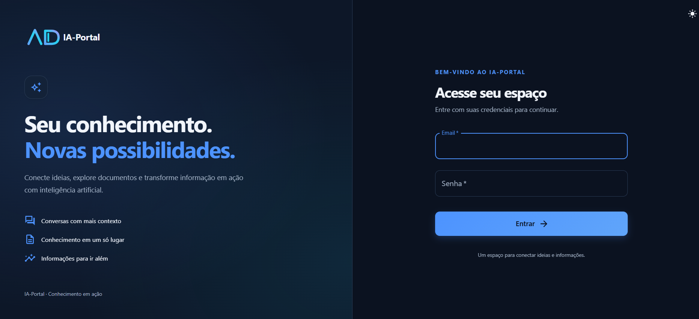
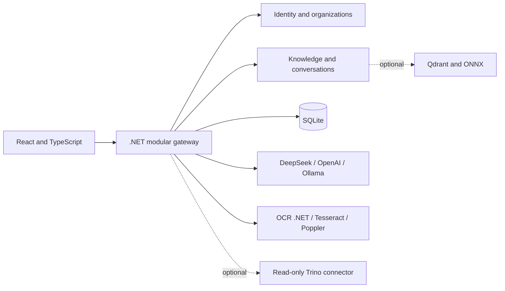

# IA-Portal — Enterprise knowledge, data connectors and AI

A self-hosted enterprise knowledge platform combining a **.NET 8 API**, **React/TypeScript interface**, **SQLite persistence**, document OCR, approved data connectors and explicit LLM routing. The direction is a shared Community core and future managed **IA-Portal Cloud**, with contributions through pull requests. No separate commercial edition or payment gateway is implemented.

> **Status: development-stage platform, not production-ready.** Community/Cloud is the product direction; no open-source license has been selected yet. Managed hosting, configurable agents, official external channels and billing remain planned. Optional vector RAG requires additional setup.

Start with [self-hosting](docs/SELF_HOSTING.md), the [current-state audit](docs/architecture/CURRENT_STATE.md),
[target architecture](docs/architecture/TARGET_ARCHITECTURE.md) and [product roadmap](docs/ROADMAP.md).
Contribution and disclosure guidance: [CONTRIBUTING](CONTRIBUTING.md), [SECURITY](SECURITY.md),
[CODE_OF_CONDUCT](CODE_OF_CONDUCT.md). [Apache 2.0 and AGPLv3](docs/LICENSE_OPTIONS.md)
are documented alternatives pending an owner decision; neither is applied automatically.

Organization workspaces reuse the existing tenant middleware: initial organization,
multiple memberships, Owner/Admin/Member/Viewer policies, protected final Owner,
organization model defaults and isolated per-organization personal preferences.
The **Organizações** screen provisions workspaces and imports one versioned,
synthetic technical-support knowledge template. Existing custom groups/data remain
supported. Provider credentials/endpoints are still installation-owned; tenant
vaults, invitations and the complete [setup wizard](docs/features/SETUP_WIZARD.md)
are future work.

Technical documentation and the incremental chat-platform plan are indexed in [docs/README.md](docs/README.md). The [current audit](docs/architecture/AS_IS_AUDIT.md) distinguishes implemented behavior from proposed conversation, usage, and provider features.

## Interface

Interface em português, com tema escuro por padrão e opção de tema claro.



## What works in local mode

The chat supports separate conversations per authenticated user and organization: create, search, rename, remove from history, reopen, and progressively load earlier messages. Conversations are recovered from the server across browsers. Existing sessions with unverified ownership are preserved but not automatically reassigned. See [conversation behavior and SQLite migration](docs/features/CHAT_SESSIONS.md). Automatic titles, token accounting, and provider selection are available; configuration details appear below.

- Automatic creation of a local SQLite database on first run.
- Initial administrator bootstrap through environment variables; no hardcoded default password.
- JWT login, knowledge-base entries, streaming chat, persisted conversations, and response ratings.
- **Text-based context selection**, not semantic/vector search: up to eight excerpts are selected from the 200 most recent active knowledge entries.
- PDF/image upload, extraction through a separate OCR service, and analysis through the configured AI provider.
- A basic metrics dashboard.

Local mode does **not** require Qdrant, Trino, or ONNX models. AI responses require a configured provider: DeepSeek/OpenAI with your own API key, or an explicitly configured local Ollama endpoint and installed model. DeepSeek remains the compatible default; OpenAI/Ollama start disabled. Uploaded document content, selected knowledge context, and conversation history may be transmitted to the configured AI provider. Do not use real confidential data in this prototype.

## Architecture

| Component | Technology and purpose |
| --- | --- |
| `front/` | React, TypeScript, Vite, Material UI; Nginx in Docker |
| `ai-gateway/` | ASP.NET Core / .NET 8 API, EF Core with SQLite, authentication, knowledge, chat, and AI/OCR integration |
| `ocr-service/` | .NET 8 service using Tesseract and Poppler for images and PDFs |
| `ml-service/` | Demonstration service with simulated portfolio projections; **not a trained predictive model** |
| SQLite | Local storage for users, knowledge, conversations, and ratings |
| Optional advanced RAG | Qdrant vector retrieval, ONNX embeddings and reranking, and optional Trino queries |



## Quick start with Docker

**Requirements:** Docker Compose, locally generated authentication credentials, and at least one configured AI provider (remote API key or local Ollama model).

1. Copy `.env.example` to `.env` (for example, `Copy-Item .env.example .env` in PowerShell).
2. Set the following values in `.env`:

| Variable | Description |
| --- | --- |
| `DEEPSEEK_API_KEY` | Your AI provider API key |
| `JWT_KEY` | Random JWT signing secret of at least 32 bytes |
| `ADMIN_EMAIL` | Initial administrator email |
| `ADMIN_PASSWORD` | Initial administrator password of at least 12 characters |
| `USE_ADVANCED_RAG` | Keep `false` for the default local mode |

3. Start the application:

```powershell
docker compose config --quiet
docker compose up --build
```

- UI: http://localhost:9080/login
- API Swagger UI: http://localhost:9089/swagger

The Compose ports bind to `127.0.0.1` by default. The named `portal_data` volume persists SQLite data. `docker compose down` preserves volumes; `docker compose down -v` removes them. The bootstrap administrator is created only when there are no users; changing `ADMIN_PASSWORD` afterward does not reset an existing password.

The document-upload control accepts PDF, PNG, and JPEG files up to 20 MB. OCR and AI analysis require their respective services to be available.

## Run components outside Docker

Requirements: .NET 8 SDK, Node.js 22.12+, and Yarn Classic 1.22.22. For OCR outside Docker, use Linux/WSL with Bash, Tesseract CLI (Portuguese and English language data), and Poppler (`pdftoppm`) on PATH. On Ubuntu: `sudo apt-get install tesseract-ocr tesseract-ocr-por tesseract-ocr-eng poppler-utils`.

Configure these environment variables for the gateway process:

- `Jwt__Key`
- `Bootstrap__AdminEmail` and `Bootstrap__AdminPassword`
- `DEEPSEEK_API_KEY`
- Optional: `ConnectionStrings__PortalConnection` (defaults to `Data Source=data/portal.db;Foreign Keys=True`)
- Optional: `OCR_SERVICE_URL` (defaults to `http://localhost:9082`)

The root `.env` is read by Docker Compose, **not automatically by .NET**.

```powershell
cd ai-gateway
dotnet run --urls http://localhost:9089
```

Start OCR and ML in separate terminals (their launch profiles use ports 9082 and 9081, matching the gateway defaults):

```powershell
dotnet run --project ocr-service/OcrService.csproj
dotnet run --project ml-service/MlService.csproj
```

In a separate terminal:

```powershell
cd front
yarn install --frozen-lockfile
yarn dev
```

Vite serves the UI on port 5173 and proxies `/api` to the gateway. See `front/.env.example` for frontend API origin configuration; never put secrets in Vite environment variables.

To run only the OCR service in Docker:

```powershell
docker compose run --rm -p 127.0.0.1:9082:8080 ocr-service
```

**Schema evolution:** initialization uses versioned SQL migrations with checksums and consistent backups before upgrading existing SQLite schemas. `EnsureCreatedAsync` is used only for an empty installation. Migrations v5/v6 add organizations and connectors; v7 adds membership policies and tenant model settings without recreating the existing database. Earlier SQL Server installations are not imported automatically.

## Optional advanced RAG

See [local RAG setup](docs/RAG_LOCAL.md) for model placement and activation. The vector chat flow uses knowledge retrieval without invoking the SQL planner or Trino.

Advanced retrieval is separate from the default local workflow. It requires compatible external models/tokenizers and additional infrastructure.

Expected model paths include:

```text
models/embeddings/nomic-v15/model.onnx
models/embeddings/nomic-v15/tokenizer.json
models/reranking/model.int8.onnx
models/reranking/tokenizer.json
```

The embedding configuration expects 768-dimensional vectors. Check model compatibility and licensing yourself.

1. Set `USE_ADVANCED_RAG=true`.
2. Run `docker compose --profile rag up --build`.
3. Configure Trino separately if analytical SQL queries are needed; Trino is not included in the Compose stack. `trino/examples/` contains synthetic demonstration data.
4. Reindex knowledge entries using `/api/kb/reindex-all`. Entries created in local mode do not automatically have vector indexes.

The advanced path is an optional integration, **not a claim of turnkey production-ready RAG**. Trino must be configured with restricted, read-only permissions before any real data source is connected.

## Build and smoke tests

```powershell
dotnet build ai-gateway/AiGateway.csproj
dotnet build ocr-service/OcrService.csproj
dotnet build ml-service/MlService.csproj
python scripts/smoke_local.py
cd front
yarn build
```

The local smoke test uses a real API and temporary SQLite database, but substitutes HTTP test doubles for the AI provider and OCR service. It does **not** validate live model quality, Tesseract extraction, ONNX inference, Trino connectivity, or browser-based end-to-end flows. Build and local validation results are recorded in [the local build report](docs/VALIDACAO_LOCAL.md).

## Security and publication notes

User and group administration is available at `/users` and `/groups` to accounts with `access.manage`. Groups grant screen access to chat, dashboard, knowledge viewing/editing, and administration. Permissions are enforced by the API on every request; see [the access-management guide](docs/ACCESS_MANAGEMENT.md) for setup, session changes, tests, and limitations.

**Do not expose this application to the public internet as-is.** The [publication review](docs/REVISAO_PUBLICACAO.md) records outstanding work, including:

- Rotating any credentials previously exposed in earlier local materials.
- Continuing security review beyond the implemented screen permissions, administrative authorization, and per-user conversation ownership checks.
- Validating enterprise Trino ACLs/TLS and extending the reviewed analytics plans beyond the Atlas schema. Arbitrary AI-generated SQL is disabled.
- Reviewing untrusted Markdown/HTML, OCR resource limits, temporary-file cleanup, CORS, HTTPS, and data retention.
- Validating operational backup, retention, and recovery procedures beyond the implemented local SQLite migrations.

The local working directory may contain **private, unredacted originals** under `.private-originals/`. This directory is Git-ignored, but **a manual ZIP of the entire working folder can still include it**. Do not upload or distribute those materials.

For a reviewed source-only export:

```powershell
python scripts/export_public.py
```

Inspect the generated `.publication/` directory and its SHA-256 manifest before sharing. Pattern-based scans cannot prove that all sensitive information has been removed. Confirm repository history and external copies separately.

## Scope, ownership, and license

This public version is a generalized demonstration. It must not be interpreted as containing any organization's private source code, datasets, credentials, or full internal implementation.

**No open-source license has been selected.** Do not assume reuse or redistribution rights. Verify ownership and third-party dependency/model licenses before publishing a license.

For a detailed Portuguese audit and the current list of limitations, see [docs/REVISAO_PUBLICACAO.md](docs/REVISAO_PUBLICACAO.md).

Automatic conversation titles are generated after the first successful response, with a safe first-question fallback and manual edits preserved. Title-call usage is stored separately; persistent chat/document usage metrics and optional versioned pricing are now available through protected APIs; provider settings, personal preferences and consumption screens are available at `/settings/ai` and `/usage`. See [usage documentation](docs/features/USAGE_METERING.md). See [chat documentation](docs/features/CHAT_SESSIONS.md).

AI settings and consumption: [configuration, permissions and limits](docs/features/AI_SETTINGS.md). API keys remain server environment variables; the UI never reads or stores their values. Automatic fallback between providers is disabled.

## Atlas demonstrativo

A demonstracao sintetica inclui dez documentos opt-in, dataset deterministico,
organizacoes, Data Connectors e chat documental/analitico/hibrido, com planos SQL
fechados, tabela, proveniencia e graficos. [Executar localmente com Compose](docs/demo/ATLAS_LOCAL.md),
[politicas de conectores](docs/demo/DATA_CONNECTORS.md) e [escopo do chat Atlas](docs/demo/ATLAS_CHAT.md).
As migrations v5/v6 preservam o SQLite existente com backup; Atlas fica separado
da organizacao padrao. Trino Memory e opcional e perde o dataset ao reiniciar.
Nao existe SQL livre gerado por IA nem cadastro irrestrito de destinos de rede.
