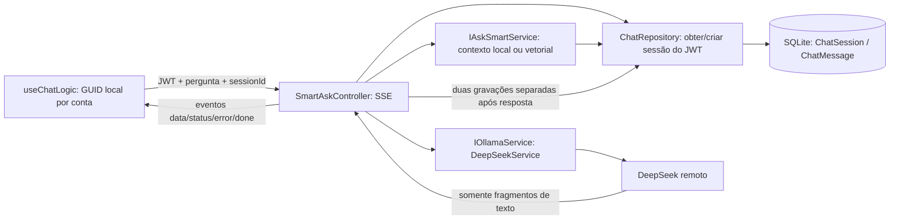

# Auditoria do estado atual — Fase 2

Data: 01/11/2026. Base inspecionada: `ec9d14e` (`main`), com a entrega de usuários em `f44b803`. Branch de trabalho: `feature/chat-sessions-providers`.

**Registro histórico da etapa 0:** auditoria concluída, proposta posteriormente aprovada pelo proprietário. Nenhuma entidade, API, adapter ou banco foi alterado durante a auditoria. A implementação posterior da etapa 1 está descrita em [CHAT_SESSIONS.md](../features/CHAT_SESSIONS.md). Os resultados de execução estão em [IMPLEMENTATION_LOG.md](../delivery/IMPLEMENTATION_LOG.md); evidências da entrega anterior não são apresentadas como testes novos.

## Inventário confirmado

| Área | Evidência no repositório | Resultado |
| --- | --- | --- |
| JWT e políticas | `ai-gateway/Program.cs`, `Security/PortalAccess.cs`, `Controllers/Auth/AuthController.cs` | Valida assinatura, issuer, audience e validade. Identidade vem de `ClaimTypes.NameIdentifier`; conta ativa e versão da senha são verificadas. Papéis/permissões são relidos no SQLite por requisição. |
| Administração | Controllers de `Users`, `Roles`, `Permissions` e `RolePermissions` | Exigem `access.manage`; DTOs de usuários não retornam hash. Login é anônimo; `/api/auth/me` exige autenticação. |
| Chat usado pela interface | `Controllers/Chat/SmartAskController.cs`, `Dtos/AskSmartRequest.cs` | `POST /api/ia/ask/stream`, política `chat.access`, recebe pergunta e GUID. Provedor injetado globalmente; modelo passado é fixo. |
| Outros caminhos | `Controllers/Chat/ChatBotController.cs`, `SqlController.cs`, `ChatRagController.cs`, `Controllers/Ocr/OcrController.cs` | Chat sem streaming, SQL, avaliação e OCR continuam existentes. Não devem virar caminhos alternativos sem verificação de propriedade. |
| Contexto | `Infrastructure/Qdrant/Services/Chats/LocalChatContextService.cs` e `VectorChatContextService.cs` | Recuperam até 20 mensagens; limitam conteúdo por mensagem a 4.000 caracteres. RAG vetorial não usa Trino. Prompt concatena papéis como texto, em vez de enviar mensagens estruturadas ao adapter. |
| Persistência | `Infrastructure/EF/Context/PortalDbContext.cs` | SQLite; tabelas físicas `ChatSession` e `ChatMessage`, mais usuários/RBAC/KB/ratings. Sessão já possui GUID, `UserId` textual opcional, `Title` opcional e criação. Mensagem já possui ID longo, sessão, papel, conteúdo e horário. |
| Repositório | `Application/Interfaces/IChatRepository.cs`, `Infrastructure/EF/Repository/ChatRepository.cs` | Sessões novas recebem o ID do JWT, ignorando o `userId` recebido. Leitura de histórico exige dono correspondente. `AddMessageAsync` não revalida propriedade. |
| Esquema | `Infrastructure/EF/DatabaseInitializer.cs` | `EnsureCreatedAsync` e seed idempotente. Sem migrações EF, histórico versionado de SQL ou procedimento de backup/restauração implementado. |
| Sessão no frontend | `front/src/hooks/useChatLogic.ts` | GUID gerado no navegador, salvo em `portal_session_id_{userId}`; uma sessão por conta/navegador. Recarregar depende dessa chave. |
| Histórico visível | `front/src/pages/ChatPage.tsx`, `components/ChatPage/*` | Consome `GET /api/chatBot/history/{sessionId}`. Backend devolve até 100 mensagens, sem ID, cursor, status ou metadados do modelo. Interface usa GUID novo quando falta ID. |
| Sidebar antiga | `front/src/components/SidebarHistory.tsx` | Não está integrada ao shell; consulta `/api/chatBot/sessions`, rota que não existe. Não representa funcionalidade pronta e precisa usar tokens visuais atuais. |
| Upload | `useChatLogic.ts`, `Controllers/Ocr/OcrController.cs` | PDF/imagem envia `sessionId` multipart; extração e LLM precedem a rejeição de sessão alheia. Documento/análise viram duas mensagens. |
| Configuração de IA | `Program.cs`, `.env.example`, `docker-compose.yml` | `IOllamaService` resolve para DeepSeek. Compose passa a chave DeepSeek, mas não passa `OPENAI_API_KEY`, endpoint/modelos OpenAI/Ollama ou mesmo todas as opções suportadas pelo adapter DeepSeek. Não foi lido o `.env` real. |
| Métricas atuais | `Controllers/KbAnalytics/ChatKbAnalyticsController.cs` | Métricas de avaliações, não tokens nem custos. `by-user` e busca de avaliações são globais sob `dashboard.view`, não `access.manage`; não reutilizar essa política para o consumo administrativo. |
| Testes existentes | `scripts/smoke_local.py`, `tests/access/*`, `tests/RagSmoke/*`, `tests/ui/*` | Cobrem login, permissões, persistência básica, OCR simulado, isolamento de leitura do histórico e RAG com modelos reais. Não há cobertura pronta de CRUD de sessões, migração de esquema, títulos ou usage. |

## Fluxo atual

## Provedores existentes

| Adapter | Situação real | Incompatibilidades e riscos |
| --- | --- | --- |
| `Infrastructure/Qdrant/Services/LLMs/DeepSeekService.cs` | Ativo via `IOllamaService`, endpoint de ambiente ou padrão remoto, chave no backend | Streaming sobrescreve o modelo com `deepseek-chat`; chamada simples sobrescreve com padrão configurado. Retorna só texto e descarta usage. Parser indexa `choices[0]` sem validar array vazio; erros podem incluir resposta bruta do provedor. |
| `.../OpenAiService.cs` | Implementa a mesma interface, mas não está selecionado na injeção de dependência | Modelo e endpoint fixos. Chamada simples lê/injeta prompt de arquivo; streaming tem semântica diferente. Grava payload completo em `logs/openai-request-*.json`. Descarta usage e não trata adequadamente chunk com `choices=[]`. Não foi realizada chamada real. |
| `.../OllamaService.cs` | Implementa a mesma interface; não está selecionado para chat. Há registro separado de HttpClient para a classe concreta | Usa endpoint cloud, modelo cloud fixo e **credencial literal no código**. Não é a integração local configurável pedida. Loga resposta bruta, mistura `thinking` com texto final e encerra em `done` antes de mapear estatísticas. Não foi testada validade da credencial nem conectividade. |
| `Infrastructure/Qdrant/Services/OllamaPdfService.cs` | Serviço auxiliar registrado; nenhuma chamada encontrada no código dos controllers | Não é o adapter principal. Usa loopback fixo e multipart com contrato próprio; não substituir o OCR funcional por esse caminho sem validação. |

**Bloqueio de segredo:** a credencial literal do adapter Ollama deve ser tratada como exposta. O responsável deve revogá-la/rotacioná-la no provedor; remover o literal do código não revoga a credencial nem limpa commits anteriores. Nenhum valor foi transcrito neste documento ou testado. Remover esse uso e os logs de payload antes de habilitar os adapters alternativos. Esta auditoria não modifica o código, conforme a etapa 0 solicitada.

## O que as APIs podem informar sobre consumo

A interface `IOllamaService` retorna `Task<string>` e `IAsyncEnumerable<string>`; não transporta usage, status, modelo efetivo ou identificador de requisição. Portanto **nenhum consumo real está sendo persistido atualmente**.

- DeepSeek documenta entrada, saída, total e cache hit/miss; cache integra a entrada, não deve ser somado novamente. O adapter precisa ler usage independentemente do conteúdo de `choices`. [Referência oficial](https://api-docs.deepseek.com/api/create-chat-completion/).
- OpenAI Chat Completions permite solicitar usage no streaming com `stream_options.include_usage`; o chunk de uso pode ter `choices` vazio. Stream interrompido pode não entregar essa informação. [Referência oficial](https://developers.openai.com/api/reference/resources/chat/subresources/completions/methods/create).
- Ollama `/api/generate` informa `prompt_eval_count`, `eval_count`, cache quando disponível e durações em nanossegundos. Mapear a resposta final antes de encerrar o stream. Não presumir paridade entre versões/servidores. [Referência oficial](https://docs.ollama.com/api/generate).

As fontes foram consultadas para planejar o contrato; não comprovam a integração real deste repositório. Os modelos atuais não serão trocados com base em exemplos dessas páginas. Não foi consultada nem inventada tabela de preços.

## Lacunas priorizadas

| Prioridade | Evidência | Ação proposta |
| --- | --- | --- |
| Crítica | Credencial embutida no adapter Ollama inativo | Remover dependência do literal, documentar revogação e impedir habilitação sem configuração segura. Nunca copiar o valor para `.env.example`. |
| Alta | `AddMessageAsync` grava sem filtro de dono; consulta de mensagens filtra dono em etapa separada | Escopo por proprietário dentro de cada query de leitura/escrita; transação e validação no repositório, inclusive nos caminhos legados e OCR. |
| Alta | SSE inicia HTTP 200 antes de validar propriedade; OCR pode chamar serviços antes de rejeitar sessão alheia | Autorizar sessão antes de abrir stream, extrair documentos, recuperar contexto ou chamar qualquer LLM. Retornar 404 genérico para sessão inexistente/alheia. |
| Alta | Duas chamadas independentes a SaveChanges após stream; falhas/cancelamento não têm registro durável | Persistir pergunta antes da chamada, registrar estado e resposta atomicamente, com ID de requisição e prevenção de duplicação. Não manter transação SQLite aberta durante rede. |
| Alta | `EnsureCreated` não evolui banco já existente | Introduzir baseline e alterações SQL versionadas, transacionais e testadas sobre esquema antigo, com backup consistente/restauração verificados. |
| Alta | Payloads completos/raw em adapters e erros encaminhados ao SSE | Remover persistência de prompts em logs e sanitizar erro público, sem perder diagnóstico por request ID. |
| Média | Sessão única local; título não preenchido; sem última atividade/paginação/índices de consulta | Reutilizar `ChatSession`, adicionar metadados/índices e APIs de CRUD/histórico. |
| Média | Ordenação apenas por horário e `Include(Messages)` ao obter sessão | Ordenar por horário e ID, remover carregamento integral e usar cursor estável. |
| Média | Modelo/provedor global e usage perdido | Evoluir a interface existente para resultados/eventos tipados; normalizar usage por adapter antes de introduzir seletor. |
| Média | Métricas globais atuais são de avaliação | Criar políticas explícitas de consumo próprio/global, sem dar acesso global a quem apenas abre o dashboard. |

## Decisões propostas para revisão

1. Reutilizar tabelas, repositório, controllers e adapters existentes; `ChatSession` será a conversa. Não criar outra tabela `Conversation` com o mesmo propósito.
2. Manter rotas de envio/SSE e OCR, acrescentando contratos de sessão em `/api/chatBot/sessions`. O componente antigo apontava para essa rota, mas ela ainda não existe. Contratos completos em [API_CONTRACTS.md](API_CONTRACTS.md).
3. Acrescentar dono tipado verificável sem atribuir automaticamente sessões legadas por coincidência de GUID/ID. Preservar conteúdo antigo, mas mantê-lo fora das APIs novas até associação explicitamente revisada.
4. Exclusão inicialmente lógica, com confirmação, preservando integridade de telemetria e dados locais; política de retenção/eliminação definitiva será documentada antes de exportações.
5. Adotar migrações SQL ordenadas com tabela de versões e checksum, baseline real validado e sem `EnsureDeleted`. Não alternar simplesmente `EnsureCreated` por `Migrate` no banco em uso. A incompatibilidade de inicializadores é documentada pelo [EF Core](https://learn.microsoft.com/en-us/ef/core/managing-schemas/ensure-created).
6. Na etapa de títulos, acrescentar contrato mínimo de resultado detalhado e registro de chamada para separar o consumo auxiliar desde o início. A etapa de métricas amplia streaming/agregações; a seleção de múltiplos provedores permanece posterior. Isso evita gerar títulos pagos sem registro nem criar uma arquitetura paralela.
7. Manter chaves no ambiente, preços ausentes como não configurados e nunca usar fallback silencioso de provedor.

## Próximo incremento e critérios de aceite

**Etapa 1:** migração aditiva, CRUD de sessões do usuário, mensagens paginadas, persistência robusta, isolamento nas operações atuais e nova conversa/lista básica no chat. Sem títulos por IA, configuração de provedores ou indicadores de consumo neste incremento.

Arquivos previstos: `PortalDbContext.cs`, inicializador e scripts/runner de migração; `IChatRepository.cs`/`ChatRepository.cs`; controllers ChatBot/SmartAsk/OCR; DTOs de sessão; hook do chat e lista reutilizada dentro do layout existente; testes e documentos técnicos.

Testes bloqueadores: banco vazio/legado, backup restaurável, segunda execução sem efeitos adicionais, A/B em listar/ler/enviar/renomear/excluir/OCR, rejeição antes de serviços externos, persistência após restart, IDs/cursores estáveis e idempotência. Usar serviços de teste; nenhum crédito externo.

**Parada para revisão:** exigida em `docs/delivery/ROADMAP.md` (etapa 0) e `CODEX_START_HERE.md`. O modelo de dados, contratos e comportamento dos legados devem ser revisados antes de criar entidades, rotas ou alterar o esquema.

## Atlas BI: auditoria de 06/11/2026

Main sincronizada por fetch + merge --ff-only, sem alteracoes locais. Trabalho em
`feature/atlas-business-intelligence`; PR #8 ja presente na base remota.

- Backend ASP.NET Core net8, EF SQLite. DatabaseInitializer usa ChatSchemaMigrator
  com SQL v1-v4, checksum e backup consistente antes de upgrades. Nenhum banco da
  instalacao foi aberto ou alterado nesta entrega.
- KnowledgeBaseItem ja oferece KeyName, Section, Subsection, Title, Content e
  IsActive. Repositorio e /api/kb/all e /api/kb/{id} alimentam a tela existente.
  Leitura exige kb.view; save/toggle/upsert/reindex exigem kb.manage.
- KB e RBAC sao globais da instalacao: nao existem Organization, memberships ou
  escopo de tenant. Sessao de chat tem dono autenticado, mas isso nao isola KB.
- RAG local pesquisa os 200 documentos ativos mais recentes por palavras em
  titulo/conteudo, selecionando ate oito; nao constitui busca semantica.
  Caminho vetorial usa ONNX/Qdrant e reindex autenticado separado.
- React 18/TypeScript/Vite, MUI, React Router e Axios com JWT; shell e tokens
  claro/escuro existentes preservados. /kb ja permite editar/ativar documentos.
- TrinoRestClient, QueryService, MetadataService, SqlPlannerService e DataRagService
  existem. Remover comentarios/semicolon nao valida SQL. /api/sql/ask executa SQL
  do LLM; ask-rag apenas testa prefixo SELECT. Schema vem do cliente. Nao ha
  politica de catalogos por tenant, limite efetivo de linhas ou parser seguro.
  Timeout HTTP e cinco minutos; nextUri nao tem validacao de origem; SQL e erros
  brutos entram em logs/excecoes. Nao habilitar conectores novos nesses contratos.
- Compose tem SQLite persistente, OCR/ML e perfil Qdrant; nao tem servidor Trino.
  Chat local/vetorial nao integra automaticamente o planner SQL.
- Mermaid existente usa securityLevel loose, innerHTML e fallback com diagrama
  de exemplo alheio ao pedido. Precisa sandbox e fallback textual antes da fase E.

### Plano incremental e impacto

A: snapshot incorporado v1 com dez entradas, opt-in Demo:Atlas:SeedKnowledge,
transacao insert-only por KeyName; categoria em Section e origem/versao em
Subsection e corpo. Sem alteracao de schema: nenhuma migration/rollback DDL novo.
Chaves existentes, inclusive inativas/editadas, nunca sao atualizadas. Nao
reescrever organization_base nem conceder permissoes extras. RAG vetorial requer
reindex explicito; ausencia de modelos nao bloqueia o seed local.

B: gerador offline deterministico separado do SQLite da aplicacao; tabelas CSV,
montantes em centavos e verificacao referencial/financeira, sem fontes externas.

C/D: bloqueio arquitetural real: definir organizacoes/memberships e vinculos de
KB/conectores antes de anunciar isolamento. Implementar enforcement SQL e rede,
read-only no Trino e limites antes de integrar ao chat. Credenciais por referencia
no ambiente, sem texto puro no SQLite. Nao expor menu de operacoes sem backend.
E depende dessas protecoes e de renderizacao Mermaid segura; nao representa
funcionalidade concluida nesta etapa.

## Atlas - organizacoes aprovadas e implementadas em 07/11/2026

A aprovacao do proprietario substitui o bloqueio arquitetural anterior. SQL v5
adiciona Organizations, OrganizationMemberships e escopo em Roles,
KnowledgeBaseItem, ChatSession e ChatKbRatings. Dados legados ficam em id 1;
Atlas opt-in separado, sem migracao heuristica por prefixo dos documentos.
Mensagens e usage filtram a sessao. PortalDbContext recebe OrganizationScope
por DI, inicialmente negado, preenchido so apos autenticacao e membership ativa.
Filtros de leitura e validacao de escrita complementam os checks de dono.
Rotas KB usam queries filtradas; nao usar FindAsync para isolamento.
RBAC recalculado no tenant; usuarios e grupos administrativos ficam locais.
Conta compartilhada nao aceita redefinicao global por admin do tenant.
Qdrant filtra organizationId e resultados sao revalidados no SQLite antes
de reranking; pontos legados sem escopo exigem reindex.
Configuracao de provedores permanece global e apenas no tenant padrao. O seletor
usa header validado e recarrega o app para impedir mistura de estado local.
Trino/conectores e Mermaid ainda sao trabalho seguinte, nao testes concluidos.

## Atlas - estado apos C/D/E em 07/11/2026

As lacunas do executor Trino/Mermaid registradas nas secoes historicas acima
foram tratadas neste incremento: SQL livre falha fechado; ApprovedTrinoQuery
compila apenas planos tipados conhecidos, totalmente qualificados. TrinoRestClient
reutilizado com IP pinning, allowlist de origem no nextUri, sem proxy/redirect,
limites/timeout/cancelamento e auditoria sem SQL/segredos. Perfis sao do servidor;
conexoes/grants locais em SQL v6. Credenciais referenciadas por ambiente, sem
coluna secreta. Fonte public precisa de origem/licenca revisadas; nenhuma foi
habilitada ou verificada automaticamente.

BusinessChatContextService envolve os contextos local/vetorial existentes,
classifica intenções de forma determinística e combina documentos com planos
aging/aging_trend/cashflow/top_balances. Fonte/data sao explicitas; ausencia de
dados produz resposta local honesta, sem inferencia nem tokens ficticios. Saida
financeira conferivel e anexada pelo servidor. AllowExternalLlm controla egress
de resultados nao-demo; respostas estruturadas nao sao retransmitidas pelo
historico de contexto, mas continuam visiveis no historico de exibicao. Titulos
locais usam fallback sem chamada paga. Nenhuma instrucao recuperada muda grants.

Recharts existente renderiza series numericas validadas e tabela alternativa.
Mermaid passa por parsing estrito e iframe opaco com CSP sem scripts/rede;
configuracoes/callbacks sao rejeitados, erro conserva codigo original. HTML raw
continua desabilitado no Markdown e imagens remotas nao carregam automaticamente.
Frontend preserva shell/temas, tem seletor de organizacao/fonte e remonta o
workspace em troca de tenant, inclusive sincronizacao entre abas.

Validado em Trino 484 local com dataset real sintetico e conta reader read-only;
nao validado com modelos pagos, RAG vetorial real ou fontes empresariais/publicas
externas. Os planos financeiros sao Atlas, nao um parser SQL analitico generico.
Veja docs/demo e IMPLEMENTATION_LOG para resultados e limitacoes precisas.

## Operacao local posterior autorizada - 07/11/2026

O proprietario autorizou excluir os dados locais sem backup. Os volumes do
portal e Qdrant foram verificados/removidos e a instalacao foi recriada em schema
v6 com um administrador, dez documentos exclusivamente Atlas e uma conexao
Trino com sete tabelas. Organizacao tecnica padrao permanece vazia de negocio.
Override Atlas ativa OnlyKnowledge, PreferOrganization e RAG textual; .env local
seleciona o override para docker compose comum. Nenhum segredo foi publicado.

Frontend/API/Trino reais ativos, fonte/grants testados e uma conversa hibrida
foi validada no Chrome com DeepSeek real (modelo efetivo deepseek-flash), tabela,
politica citada e grafico. Calls de resposta/titulo totalizaram 3610 tokens reais.
Restart do gateway preservou docs/conexao/conversa sem duplicar ou criar backup.
A limitacao anterior de "LLM pago nao executado" descreve a entrega inicial e
foi superada para esse smoke local; nao representa auditoria ampla do modelo
ou validacao de fontes empresariais/publicas externas. Diario contem detalhes.

## 2026-11-07 — Auditoria OCI Always Free e preparo de automação

Somente leitura remota, sem provisionamento/deploy. Nova branch
feature/oci-always-free criada a partir de main limpa após merge do PR #9.
CLI Windows 3.96.0 autenticada por API Signing Key; Home sa-saopaulo-1 e um AD.
Inventário raiz/subcompartments não encontrou VMs, boot/block volumes nem quotas
customizadas. Shape A1 billing-type LIMITED_FREE; recursos disponíveis e imagem
oficial Ubuntu 24.04 aarch64 compatível confirmados via APIs OCI. O relatório
mensal de uso retornou vazio, sujeito ao atraso de billing.

VCN 1 sem default route. VCN 2 com subnet pública, rota default para IGW ativo
da mesma VCN, mas security list abre SSH para todos e não permite HTTP/HTTPS.
Nenhum NSG existente encontrado. Dry-run real recusou provisionamento por essas
regras; nenhuma alteração remota foi executada. Proposta de ingress foi gerada
apenas em artifacts/oci-audit (ignorado), aguardando autorização do proprietário.

Compose inspecionado: SQLite, gateway .NET, frontend React/Nginx, ML/OCR .NET,
Qdrant opcional e Trino Atlas. Sem PostgreSQL ou container Python/ReRAG. Todos
os manifests das imagens-base consultadas oferecem ARM64; isso não comprova
workload. MKL Redist não contém linux-arm64; ONNX/tokenizer contêm, mas inferência
nativa não foi testada nessa arquitetura. OCR atual usa executáveis de sistema.
Compatibilidade integral ARM64, dimensionamento e hardening/deploy permanecem
para outra etapa. Detalhes e evidências em infra/oracle/README.md.

## 2026-11-07 — Community/shared-core audit and workspace increment

The new English [CURRENT_STATE.md](CURRENT_STATE.md) is the baseline audit for
the shared self-hosted/managed-core direction. Existing organizations/filters
were confirmed before changes. Organization provisioning/policies, scoped model
preferences/defaults and the selector fix are the bounded increment; see the
[delivery report](../delivery/COMMUNITY_WORKSPACE_REPORT.md) for migration 007,
legacy policy, actual tests and remaining SaaS/security/ARM64 limits. No license
selected, application deployed or Oracle resource modified in this task. The
previous local OCI retry process was stopped to respect that instruction.

## Follow-up audit: invitations and ownership — 2026-11-08

Re-read AGENTS and existing delivery/product roadmaps before changes. Initial tree
was clean. Fetch still showed origin/main at 90b5b86; continued in a new
feature/organization-invitations branch from the delivered cef803c, preserving
the previous commits without merging main. Existing JWT identity, scoped entities,
workspace policies, frontend selector and v7 migrations were reused.

No invitation table/service or explicit ownership-transfer UI existed at this
baseline. Added only existing-account capability invitations and atomic transfer,
with v8 migration preservation, consent/isolation/concurrency tests and actual API
smoke. No global account lookup, email delivery or tenant credential editor is
claimed. See [the report](../delivery/INVITATIONS_REPORT.md). The user subsequently
authorized/restarted the independent OCI retry runner; this follow-up leaves it
alone and makes no remote OCI changes or live application/database upgrades.

## 2026-11-08 — Channel integration audit and local vertical

Initial tree clean; fetched origin/main at a9ec52c and created
feature/service-whatsapp. Existing organization/invitation functionality was
present. Reviewed JWT/database permission refresh, OrganizationScope/EF guards,
user-owned chat repository, LocalChatContextService, VectorChatContextService,
KnowledgeBaseRagService, model adapters, migration runner, React router/MUI shell
and Compose. OCR/ML remain .NET services; Python is scripting/test tooling.

No existing channel/contact/agent adapter existed. Reused local textual selection
through LocalKnowledgeRetriever in both web chat and the constrained channel
agent. New external history avoids relaxing private web session ownership.
Five tenant-bound tables are added in v9; assignment is inline per connection,
not a second general agent framework. No old Delphi/TInject/private material or
browser automation was imported.

Primary Meta research was attempted; some developer endpoints returned429/login.
Accessible official pricing/sample references and unresolved account-specific
contracts are recorded in service/WHATSAPP_RESEARCH.md. Local simulated delivery
and signed reception are validated, not real Cloud sending/onboarding/Coexistence.
See delivery/CHANNELS_REPORT.md for exact tests and pending security/operational work.

## 2026-11-08 — Minimal cloud hosting audit

Reviewed the full Compose dependencies, Dockerfiles, proxy, lazy textual/vector
services, database initialization and chat/OCR/data routes before preparing the
owner-requested1GB deployment. Full Compose unconditionally starts OCR/ML; Atlas
adds a2GiB-limited Trino. A standalone two-container profile was therefore needed.
Existing textual retrieval/SQLite/provider adapters were reused. Minimal runtime
gates are after normal authentication/authorization; full-mode behavior remains.
New health/rate/concurrency controls and hidden unsupported UI actions were tested.
Actual deployment/secret authorization, resource observations and remaining gates
are recorded in ../../infra/oracle/MICRO_DEPLOYMENT.md. No local data was copied
to the cloud. This later deployment was explicitly authorized by the owner.

## 2026-11-09 — Full-stack capacity audit

Inspected full Compose/Atlas/RAG/model manifests and the actual existing containers
before expanding the Micro. The public portal and SSH were already unavailable.
Recovery exposed448MiB crashkernel reservation, repaired to recover946MiB RAM.
Actual disposable Linux native-RAG trials OOM at768MiB and1536MiB; Trino with
reduced query allocations still OOM at512MiB. Qdrant alone passed a tiny synthetic
query but is not equivalent to the full RAG pipeline. No model/dimension or
application code was silently changed to make the capacity claim pass.

The complete cloud stack was not installed. Minimal HTTPS/data were recovered,
verified consistent backup made and original accounts/passwords preserved. See
[the capacity/recovery report](../../infra/oracle/FULL_CAPACITY_TRIAL.md) for exact
evidence, failed authenticated-bootstrap recheck, diagnostics tradeoff and next
infrastructure gate. No paid resources or unrequested cloud shape changes.

## 2026-11-09 — WhatsApp local setup and deployment

Existing module inspection confirmed durable/signed reception and simulation,
but no Cloud sender, token editor or Embedded Signup. Added only an explicit
credential-free setup DTO/authorized route metadata and pt-BR guide in the current
channel page. No credential persistence/new migration/framework. Readiness is
configuration-only and cannot claim a verified Meta connection. The user selected
the Meta test number; actual app/assets/secrets/callback remain pending.

The existing local SQLite was stillv7. Consistent backup/fingerprints preceded
the two-service rebuild; v8/v9 applied and identities/content/history matched
afterward. Full Compose overrides, running Trino/OCR/ML and local `.env` preserved.
See [test setup/local operation](../service/META_TEST_SETUP.md).
# Server-side browser channel increment — 2026-11-09

The existing channel model already scopes connections, contacts, conversations,
messages and delivery events by validated organization identity. The new
`whatsapp-browser` provider reuses these tables and the documentary agent; no
portal schema change is necessary. Organization IDs and connection keys are
generated/validated by the gateway, not supplied as browser routing authority.

An optional Node/Chromium process now owns per-connection LocalAuth profiles and
a separate durable inbox/outbox journal. No public bridge port or browser debug
endpoint is published. The existing Canais page exposes QR/status/lifecycle,
opt-in automatic documentary responses and human-handoff manual responses.
Cloud API remains optional. Actual local Chromium generated a WhatsApp Web QR;
no account was paired and no live message exchange has been validated.

This remains an experimental single-node integration: shared-container Chromium
uses no-sandbox, profiles need private/encrypted host storage, unofficial Web
compatibility can change, and paired reconnection/soak tests are pending. See
[the implementation and operating guide](../service/WHATSAPP_BROWSER.md).
