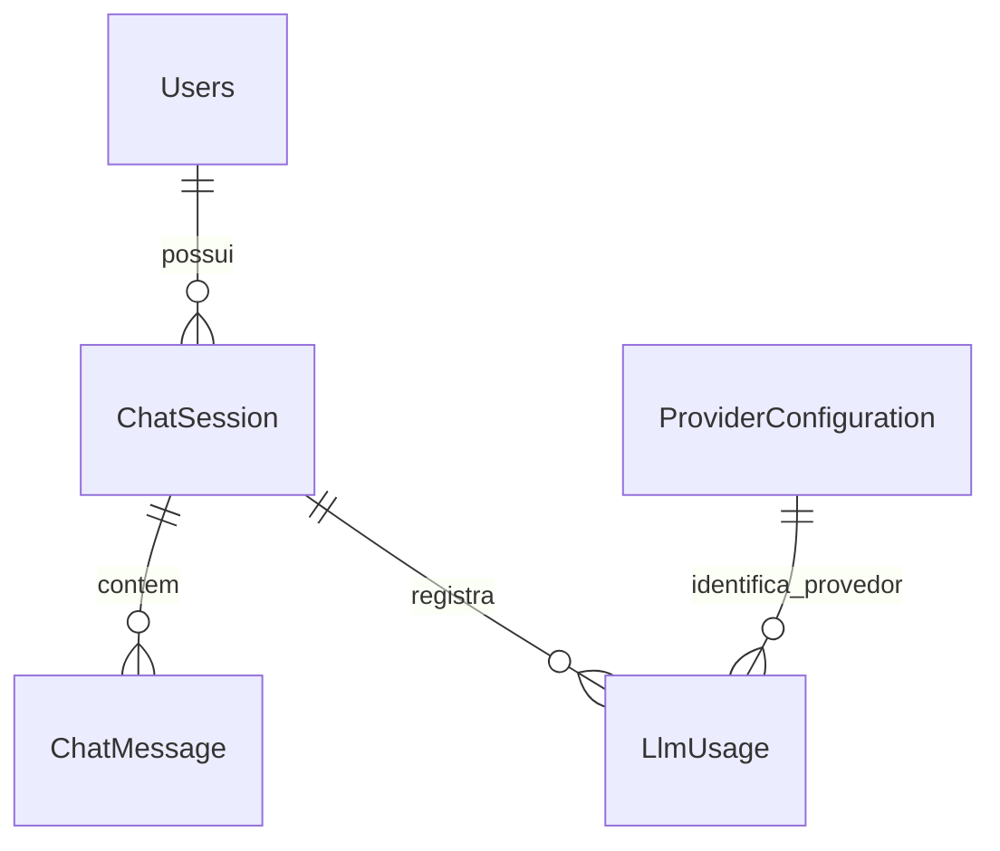

# Modelo de dados — proposta após auditoria

Data: 01/11/2026. **Modelo evolutivo: etapas 1–5 implementadas, com limites documentados.** Evidências da base anterior em [AS_IS_AUDIT.md](AS_IS_AUDIT.md). As tabelas `ChatSession` e `ChatMessage` foram reutilizadas, sem uma segunda entidade de conversa.

**Atualização após aprovação:** o proprietário aprovou a proposta e o diagrama em 01/11/2026. A etapa 1 foi implementada: migração SQL v1, `OwnerUserId`, metadados da sessão, estado/request/fingerprint nas mensagens e índices. A lease está em `ChatSession` (`ActiveRequestId`, `LeaseUntil`). A etapa 2 adicionou `LlmUsage` para tentativas de título via migração v2; a etapa 3 estende a mesma tabela para consumo de chat/documentos, custo opcional e índices via migração v3. A migração v4 adiciona configurações sem segredos, preferências e padrão global; os três adapters foram integrados. Resultados e limites em [CHAT_SESSIONS.md](../features/CHAT_SESSIONS.md) e no diário.

## Organização conceitual fornecida pelo proprietário

O diagrama enviado em 01/11/2026 orienta a separação entre usuários, sessões, mensagens, consumo e provedores. Os nomes conceituais são mapeados às estruturas existentes, sem renomear tabelas apenas para coincidir com a imagem.

| No diagrama fornecido | Mapeamento proposto no projeto | Responsabilidade |
| --- | --- | --- |
| Users | `Users` existente | Identidade autenticada e acesso; não guardar mensagens ou totais de consumo na conta. |
| ChatSessions | `ChatSession` existente | Proprietário, título, seleção atual de modelo e datas da conversa. |
| ChatMessages | `ChatMessage` existente | Papel, conteúdo, estado e modelo efetivo de cada mensagem. |
| LlmUsage | `LlmUsage`, nova na etapa de títulos/consumo | Uma linha por chamada ao modelo, inclusive chamadas auxiliares e falhas; não uma linha por sessão nem obrigatoriamente por mensagem. |
| AI Providers | `ProviderConfiguration`, introduzida na etapa de configuração | Identificador estável do provedor e configuração permitida; sem segredo em texto puro. Reutiliza os adapters existentes. |

O relacionamento com provedor será feito por identificador estável (`deepseek`, `openai`, `ollama`), não pelo nome exibido ou endpoint. Antes de existir a tabela de configuração, o registro de chamadas usa esse identificador validado no backend; a migração posterior estabelece a FK sem perder registros. Desabilitar um provedor não apaga sua identidade nem o consumo histórico. Não é necessária uma segunda tabela `AiProviders` além de `ProviderConfiguration` para representar o mesmo cadastro.

Consumo pode referenciar uma mensagem, mas esse vínculo é opcional: geração de título e chamadas que falham antes de produzir resposta também precisam de registro. Para chamadas associadas à conversa, o usuário do consumo deve coincidir com seu proprietário; o cliente não escolhe esse usuário. Chamadas administrativas de teste de conectividade poderão ter sessão nula e usuário executor autenticado, com finalidade distinta, sem inventar uma conversa.

Trocar o modelo da sessão não altera os identificadores de provedor/modelo já registrados nas respostas e chamadas anteriores. Tokens e custos ficam na tabela de consumo; totais por usuário/conversa/período são agregações dessas chamadas, evitando duplicação e divergência entre tabelas.

O desenho mostra a cardinalidade de novas conversas válidas. A exceção temporária de dono nulo em sessões legadas, necessária para preservação segura dos dados, continua descrita abaixo. O envio do diagrama refina esta proposta; a migração e os contratos ainda não foram implementados.

## Etapa 1 — sessões e mensagens

| Tabela | Já existe | Evolução proposta |
| --- | --- | --- |
| `ChatSession` | `Id` GUID, `UserId` string opcional, `Title` opcional (200), `CreatedAt` UTC | Adicionar `OwnerUserId` inteiro opcional para compatibilidade legada, FK de usuário sem exclusão cascata; `UpdatedAt`, `TitleSource`, `Provider`, `Model`, `DeletedAt` e versão de edição. Novas sessões sempre têm proprietário do JWT. |
| `ChatMessage` | `Id` long, `SessionId` GUID/FK, `Role`, `Content`, `CreatedAt` | Adicionar `Status`, `RequestId` opcional para legados, `Provider`/`Model` efetivos em respostas e estado/lease da geração. Usar ID real no frontend. |
| `SchemaVersions` (nova, infraestrutura) | Ausente | Versão, checksum do script e data de aplicação; baseline explícito e migrações ordenadas. Sem conteúdo de usuários/prompts/segredos. |

`OwnerUserId` só admite nulo para registros anteriores cuja propriedade não foi comprovada. O serviço/repositório recusa criar sessão sem dono; APIs sempre filtram `OwnerUserId` pelo JWT e `DeletedAt IS NULL`. `UserId` original permanece para preservação e auditoria da migração, mas não autoriza novas operações. Evitar rebuild desnecessário da tabela somente para transformar campo legado em NOT NULL.

`UpdatedAt` vem de criação, mensagem persistida ou renomeação; apenas abrir uma conversa não deve reordená-la. Timestamp UTC; agrupamentos Hoje/Ontem são calculados no fuso do usuário.

`TitleSource`: `provisional`, `automatic`, `manual`, `fallback` ou `legacy`. Título inicial `Nova conversa`. Título manual tem limite proposto de 120 caracteres. Títulos existentes são preservados e não devem ser regenerados silenciosamente.

`Provider`/`Model` legados permanecem nulos quando não comprovados. No primeiro incremento, novas sessões registram o provedor/modelo realmente usado pelo adapter atual, sem anunciar um seletor funcional. Trocas explícitas entram apenas na etapa 4.

### Integridade, ordem e idempotência

- Índice de sessões `(OwnerUserId, DeletedAt, UpdatedAt, Id)`; índice de mensagens `(SessionId, CreatedAt, Id)`.
- Mensagens: ordenar por `(CreatedAt, Id)`, inclusive quando horários coincidem. Não confiar em IDs gerados pelo navegador para representar registros persistidos.
- Reservar a interação antes da rede e persistir a pergunta com `RequestId`. Índice único filtrado em `(SessionId, RequestId, Role)` para o fluxo atual com uma pergunta e uma resposta por interação. Metadados de geração distinguem `pending`, `completed`, `failed`, `cancelled` e `interrupted`.
- Repetição de request concluído devolve o resultado persistido sem chamar o modelo novamente. Repetição ainda em andamento retorna conflito; mesmo request ID com conteúdo diferente também é conflito. Falha não gera retry pago automático.
- Uma geração ativa por sessão, com lease persistida, evita duas respostas disputando o contexto. Recuperar lease vencida após interrupção; não manter locks/transação durante chamada externa.
- Revalidar dono e ausência de exclusão na finalização. Exclusão lógica não permite uma resposta em andamento ressuscitar a conversa.
- Salvar resposta/estado da interação/atividade na mesma transação. Uma falha preserva a pergunta e um estado de erro, sem fabricar uma resposta vazia bem-sucedida.
- Exclusão lógica marca `DeletedAt` e retira imediatamente a conversa de leitura/envio/edição; não apagar mensagens e uso por cascata. Retenção e remoção física posterior exigem política explícita. Isso não é apagamento físico nem promessa de anonimização.

## Etapa 2 — títulos e trilha mínima de chamadas

Adicionar o registro de chamada necessário para medir o título desde sua implementação; não aguardar o dashboard de consumo para contabilizar essa operação.

| Tabela | Campos propostos | Regras |
| --- | --- | --- |
| `LlmUsage` | ID único da chamada, usuário, sessão, mensagem/request relacionados quando houver, provedor, modelo solicitado/efetivo, finalidade, status, início/fim, duração, tokens de entrada/saída/cache/total opcionais, fonte do uso, erro categorizado | Sem prompts, respostas completas, API keys ou JWTs. Uma linha por chamada; atualização idempotente. Título usa `purpose=title`. |

Título recebe somente trecho limitado da primeira pergunta e, se necessário, pequeno trecho da resposta. Após resposta persistida, executar chamada curta com timeout/limite de saída e capturar seu consumo. Falha usa pergunta truncada, sem desfazer o chat. Atualização condicional por versão/origem protege edição manual concorrente. Não criar worker em background sem ciclo de vida ou persistência definidos.

## Etapas 3–5 — uso e configuração

**Implementação da etapa 3:** reutilizada `LlmUsage`; migração v3 acrescenta `EstimatedCostNanoUsd`/`PriceVersion` opcionais e índices por mensagem/finalidade (unicidade somente chat/document), sessão/data, finalidade/data e data/ID. `MessageId` referencia a pergunta para chat/documentos e a primeira resposta para títulos. Provider/model efetivo, duração, tokens e status ficam por chamada. Preços foram implementados como arquivo JSON versionável (`ModelPriceCatalog`), sem tabela adicional: vigência e versão ficam na configuração, e a versão aplicada acompanha cada estimativa persistida. Não há recálculo retroativo. Configuração inicial vazia. `ProviderConfiguration`/`UserPreference` abaixo continuam propostos; não foram criados nesta etapa.

| Entidade proposta | Campos mínimos | Regras |
| --- | --- | --- |
| `LlmUsage` (evolução) | Custo estimado decimal USD, referência/versionamento do preço, detalhes de cache suportados e índices de agregação | Medido, estimado e indisponível são categorias distintas. Ausência de tokens/preço é NULL, não zero inventado. |
| `ProviderConfiguration` | Provider único, habilitado, endpoint validado, modelos permitidos, modelo padrão e versão | Sem chaves em texto puro; somente referência de variável de ambiente e estado configurado/não configurado. Sem URL arbitrária para credencial existente. |
| `UserPreference` | UserId/FK único, provider/model preferidos | Escolha deve continuar habilitada na configuração administrativa; não redirecionar silenciosamente para outro provedor. |
| `ModelPrice` | Provider/model, vigência UTC, unidade (USD por milhão de tokens), preços separados para entrada/saída/cache quando aplicáveis, origem do preço | Sem valores iniciais inventados. Salvar a versão usada no cálculo; mudanças futuras não reescrevem custos históricos. |

Índices de consumo: `(UserId, CreatedAt)`, `(SessionId, CreatedAt)`, `(Provider, Model, CreatedAt)`, unicidade de ID de chamada. Telemetria global exige permissão administrativa específica; posse de `dashboard.view` não basta. Nem administradores recebem automaticamente acesso ao conteúdo de conversas de terceiros.

Cache é subconjunto da entrada conforme o provedor, não parcela a somar ao total novamente. Ollama local não tem cobrança de API externa; esse fato deve aparecer separado de custo de infraestrutura desconhecido. Endpoints cloud não devem ser classificados automaticamente como execução local gratuita.

## Plano de migração e rollback

1. Implementar runner SQL versionado no inicializador existente, antes de novas queries/seed; não misturar ingenuamente `EnsureCreated` e `Migrate`. Inspecionar o esquema real com PRAGMAs e validar baseline antes de marcar versão aplicada.
2. Banco vazio: criar baseline e aplicar os mesmos passos ordenados. Banco existente: reconhecer somente o baseline esperado; esquema divergente interrompe a inicialização com erro sanitizado, sem drop/recriação.
3. Antes da primeira evolução, fazer backup consistente via API SQLite de backup (incluindo dados em WAL), em diretório privado ignorado pelo Git e volume local persistido. Falha de backup impede migrar. Não copiar apenas um arquivo aberto supondo consistência.
4. Testar a restauração desse backup e `integrity_check`/`foreign_key_check` com fixture sintética antes de usar o mecanismo no banco diário.
5. Aplicar scripts e registrar versão/checksum na mesma transação. Não usar `EnsureDeleted`, limpar dados, remover volumes ou reconstruir banco como correção automática. Duas inicializações não repetem alterações; checksum divergente bloqueia startup.
6. Preservar IDs, textos, datas, hashes, grupos e documentos. Sessões sem dono comprovado continuam guardadas, com `OwnerUserId=NULL` e sem acesso pelas novas APIs. Correspondência numérica de `UserId` com uma conta, GUID ou título não comprova a origem autenticada da gravação antiga.
7. Eventual associação legada usa mapeamento explícito revisado pelo proprietário, ferramenta com dry-run e contagens, backup e trilha; não expor prompts no relatório. Nenhum mapeamento será executado implicitamente nesta entrega.
8. Atualização deve informar ao frontend a seleção inválida/legada, sem reaproveitar GUID não autorizado nem adotar a sessão silenciosamente.
9. Rollback: parar gravações, preservar também uma cópia do banco após migração, restaurar o backup verificado e executar a imagem anterior. Avisar que voltar ao backup remove as gravações feitas depois dele. Sem downgrade destrutivo automático.

## Critérios de aceite da migração

- Fixture com esquema antigo e dados sintéticos: mesmos IDs/conteúdo após migração, índices/FKs presentes, donos legados não inferidos.
- Banco novo atinge o mesmo esquema final.
- Falha injetada faz rollback da versão e do DDL; repetir inicialização não altera contagens.
- Checksum/baseline inválidos impedem prosseguir.
- Backup restaurado mantém dados e integridade.
- Nenhum banco real foi aberto ou alterado para preparar esta proposta.

## Estado final de provedores/preferências

O identificador de provider em mensagens/usage/preferências é um snapshot lógico, não uma FK obrigatória para configuração: provedores podem funcionar só pelo ambiente, sem linha em `AiProviderSettings`, e histórico não deve depender de a configuração permanecer habilitada. Seleção runtime é validada pelo catálogo. As FKs de usuário, sessão e mensagem continuam reais; não há tabela paralela de conversas.

`AiProviderSettings` guarda Id do provedor, enabled, endpoint permitido, lista de modelos JSON, modelo padrão e versão de concorrência. `AiUserPreferences` vincula UserId ao provider/model pessoal; `AiSystemDefault` guarda provider/model/versão globais. Sem colunas de API key, segredo ou JWT. `LlmUsage.ApiBilling` separa external/local/unknown. Perguntas conservam provider/model solicitado; respostas/usage conservam efetivo; a seleção da conversa não é sobrescrita pelo alias retornado. Endpoint e classificação de cobrança são congelados juntos ao aceitar a chamada, evitando redirecionamento de uma chamada local já iniciada por edição administrativa concorrente. SQL v4/backup/checksum preservam todas as estruturas anteriores. Preços continuam em arquivo versionável, não em uma tabela adicional.

## Atlas - schema implementado v5/v6 (07/11/2026)

Organizations(Id,Name,Slug unico,IsActive) e OrganizationMemberships(OrganizationId,
UserId,IsActive), PK composta e FKs reais. Roles passa a ter OrganizationId e
unicidade por (OrganizationId,RoleName). UserRoles/RolePermissions reutilizados;
RBAC e membership validados no tenant ativo.

KnowledgeBaseItem, ChatSession e ChatKbRatings recebem OrganizationId. Mensagens
e LlmUsage conservam as FKs existentes e herdam o escopo da sessao. Usuario e
credencial continuam globais (identidade compartilhavel), mas administracao
filtra memberships e nao permite reset global de conta compartilhada por tenant.
AiProviderSettings/default continuam globais, com administracao so na org padrao.
Preferencia pessoal e da conta. Nao existe segunda tabela de conversas.

DataConnectors: Id,OrganizationId,Name,ProfileId,Category,Endpoint,Catalog,Schema,
Enabled,TablesJson,Status,TestedAt,Version (concorrencia). ConnectorGrants tem PK
(ConnectorId,RoleId), FKs e trigger impedindo grant entre organizacoes. Nao ha
coluna de segredo, senha ou API key. Referencias de ambiente existem somente
nos perfis aprovados no servidor, fora do DTO/SQLite.

Migration v5 atribui todo legado a id=1, sem inferir tenant por prefixo ou texto.
Atlas opt-in separado recebe novos documentos com mesmo KeyName logico por org;
edicoes antigas permanecem intocadas em id=1. Em SQLite legado as colunas FK
adicionadas sem NOT NULL sao preenchidas e protegidas por triggers contra NULL,
evitando reconstruir tabelas. Banco novo usa NOT NULL no modelo. v6 cria apenas
tabelas novas e seus indexes/triggers. Runner conserva SQL/checksum e backup
consistente; v4/v5 reais, rollback DDL, restore+upgrade e idempotencia testados.
