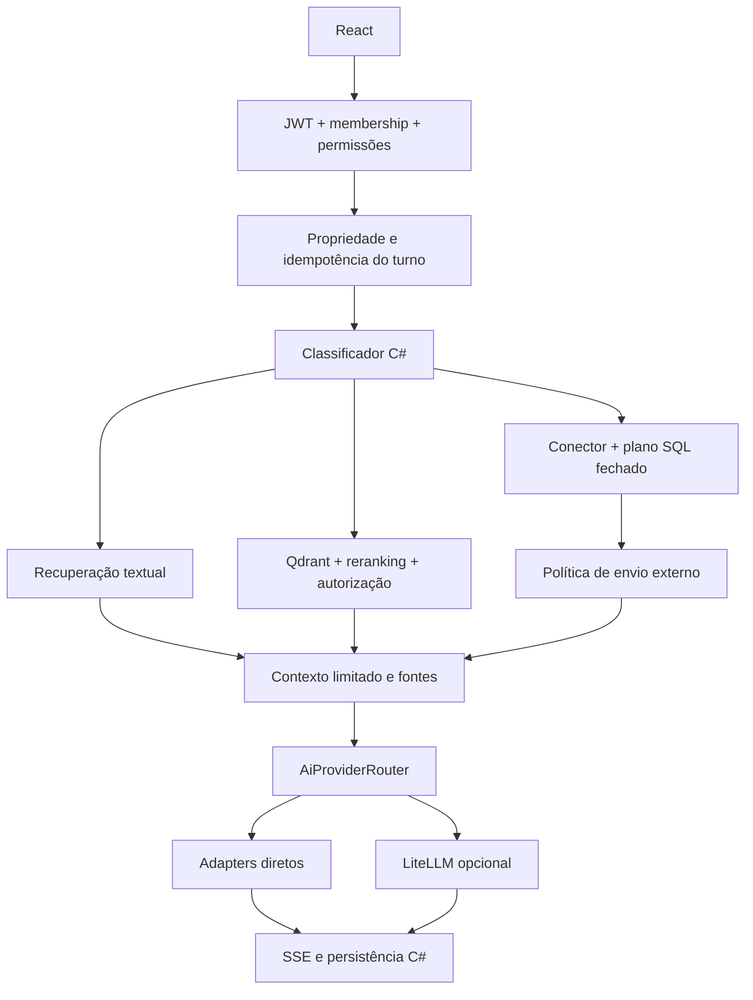
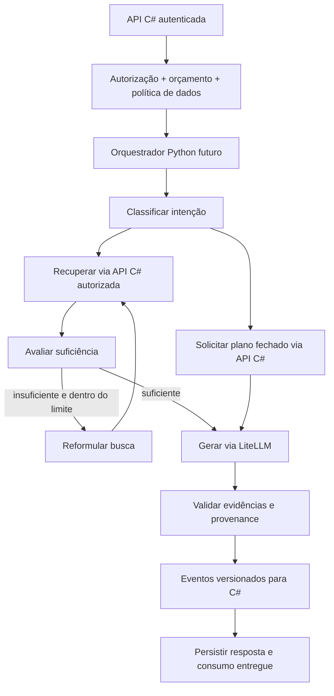

# IA-Portal: preparação para LangGraph

Proposta, não implementação. Nenhuma dependência ou serviço LangGraph foi adicionado.

## Arquitetura atual verificada

Frontend React/TypeScript/MUI, JWT, organizações, chat persistido em SQLite.
`SmartAskController` valida sessão/turno com `IChatRepository` antes de SSE.
`BusinessChatContextService` classifica intenção deterministicamente e escolhe
recuperação documental, análise por plano autorizado, híbrido ou esclarecimento.
`LocalChatContextService` usa recuperação textual limitada. O fluxo vetorial usa
ONNX embeddings → Qdrant filtrado por organização → revalidação relacional →
reranker ONNX → montagem de contexto. Reranking não é um ciclo ReRAG: não há
reformulação iterativa de busca, avaliação de suficiência ou loop de retrieval.
`AllowExternalLlm` bloqueia o envio de resultados empresariais não autorizados.
SQL livre está desativado; planos fechados ficam no C# com grants revalidados.



`IAiProviderAdapter` agrega `IOllamaService`, `ILlmMetrics` e `IChatTitleGenerator`.
Os métodos recebem string de prompt e retornam texto/IAsyncEnumerable: não
transportam tools/tool results. O proxy suporta esse protocolo diretamente,
mas introduzir tools na aplicação exigiria uma decisão separada e contratos
tipados. Telemetria de tokens usa `LlmUsage`; attempts ficam separados no gateway.

## Arquitetura proposta

C# continua como autoridade de identidade, organização, propriedade da sessão,
permissões, catálogo de fontes, egress de dados, persistência e consumo entregue.
Um serviço Python interno poderá orquestrar um grafo, recebendo somente um escopo
delegado de curta duração. LiteLLM continua responsável pelo transporte de modelos,
fallback autorizado e telemetria dos attempts. Python nunca recebe acesso direto
ao SQLite do portal, master key de administração ou SQL arbitrário executável.



O ciclo Assess/Reformulate seria o ReRAG proposto, com limite inicial de duas
recuperações e orçamento por execução. Não deve ser confundido com comportamento
atual. LangGraph oferece grafos e checkpoints; persistência de grafo não torna
automaticamente idempotentes chamadas externas ou cobrança.
[Referência oficial](https://reference.langchain.com/python/langgraph/overview).

## Contratos propostos entre C# e Python

Contrato interno versionado `POST /internal/v1/runs`, autenticação de serviço
com audiência específica, assinatura, expiração curta e proteção contra replay.
C# valida membership/grants atuais em cada callback de execução; claims delegadas
não substituem revogação. O tenant do corpo é apenas uma afirmação a confrontar
com a credencial delegada. Nunca reutilizar JWT do usuário como chave do LiteLLM.

```json
{
  "contract_version": 1,
  "organization_id": 123,
  "session_id": "uuid",
  "turn_id": "uuid",
  "request_id": "server-correlation",
  "run_id": "uuid",
  "question": "texto",
  "capability": "balanced",
  "source": {"connector_id": 7, "reference_date": "2026-11-01"},
  "policy": {"external_data_allowed": false, "max_retrievals": 2, "max_output_tokens": 1024},
  "deadline_utc": "2026-11-11T22:00:00Z"
}
```

SSE/NDJSON interno: `status`, `evidence`, `delta`, `usage_final`, `completed`,
`failed`, cada evento com `run_id`, `request_id` e sequência monotônica. O C#
continua adaptando para o SSE público existente; eventos internos não viram uma
alteração implícita do contrato do navegador. `usage_final` representa somente
resultado entregue e aponta para `portal_call_id`; attempts permanecem separados.
`evidence` inclui IDs/versões de documentos e resultados de planos autorizados,
sem dar autoridade a instruções recuperadas. Campos desconhecidos/versões
incompatíveis falham explicitamente.

Callbacks propostos de retrieval/analytics devem usar IDs de fontes/planos,
limites de resultados e grants C#; não aceitar SQL livre ou user_id para definir
autoridade. Cancelamento HTTP e endpoint de cancelamento por run autenticado
compartilham deadline. Persistência futura de checkpoints precisa de chave
`organization_id/session_id/run_id`, TTL, política de criptografia/backup e teste
de isolamento. Não usar session_id sozinho como identificador global de acesso.

## Migração incremental

1. Entrega atual: LiteLLM opcional, regressão dos adapters diretos, separação de
   usage/attempts; nenhum grafo.
2. Definir contrato versionado e testes C#/Python com fixtures sintéticas,
   autorização delegada, deadlines, replay e cancelamento. Revisar política de
   dados antes de transmitir contexto ao novo serviço.
3. Extrair somente classificação/documental para grafo em feature flag por
   organização, sem dupla inferência de produção e sem dupla contabilização.
4. Migrar sequência retrieval/reranking com paridade de fontes e autorização;
   manter os conectores e planos no C#.
5. Adicionar ReRAG limitado, avaliação de suficiência e comparação de qualidade,
   custo/latência. Definir checkpoint/deduplicação de chamadas antes de retries.
6. Só então discutir tools, aprovações humanas e novos contratos públicos.

Rollback em cada fase: desativar a flag e retornar ao pipeline C# para novos
turnos; runs em execução precisam de cancelamento/resolução explícitos. Não
reexecutar silenciosamente um turno parcialmente entregue.

## Riscos e impactos

| Risco | Tratamento necessário |
| --- | --- |
| Confundir reranking com ReRAG | Inventário acima; novo loop somente com testes e orçamento |
| Vazamento entre organizações | Escopo delegado, revalidação C#, checkpoint com tenant |
| Mais custo com retries/loops | Ledger de attempts separado, limite no provedor e orçamento persistente |
| Fallback incompatível com privacidade | Rotas locais sem destinos externos; egress validado antes do grafo |
| Repetir uma chamada após checkpoint | Idempotência por run/node/call e registro de resultado desconhecido |
| Perder cancelamento/stream | Deadline de ponta a ponta, sequência de eventos e nenhuma concatenação de retries |
| Falhas de quota/modelo | Rotas de capacidade configuráveis, cooldown e erro explícito |
| Presumir tools implementadas | Somente passagem no proxy nesta entrega; executor ausente |

Critérios para avançar: regressão de sessão/tenant, equivalência de evidências,
latência medida, custo reconciliável por organização e revisão dos contratos.
