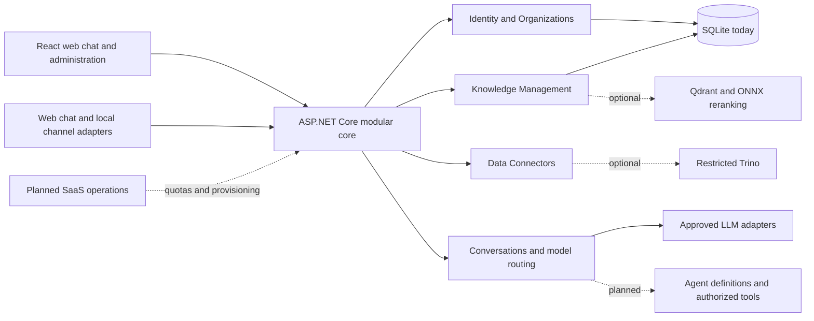
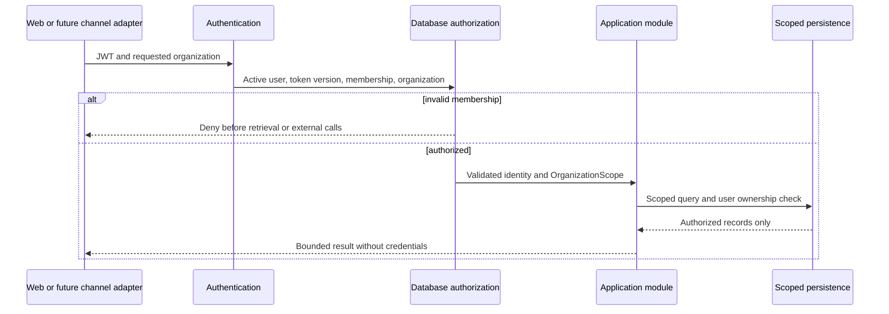

# Target architecture

Community Edition (self-hosted) and IA-Portal Cloud (future managed hosting) share
the same core. There is no separate commercial codebase, feature-gating license
server, payment adapter or additional microservice in this increment. An owner
decision on source licensing is still required.

Dashed connections are optional integrations or explicitly planned modules, not
claims of an implemented product. Logical modules remain in the existing gateway
until independent deployment has a demonstrated need. OCR/ML companion services
already exist; do not introduce a Python service just to match a diagram.

## Boundaries and contracts

| Module | Existing / this increment | Next boundary |
| --- | --- | --- |
| Identity & Organizations | JWT, validated memberships, custom groups, Owner/Admin/Member/Viewer, provisioning/selector, consenting existing-account bearer invitations and atomic ownership transfer | Verified recipient-bound onboarding/delivery, account-level password recovery/MFA |
| Knowledge | Tenant rows, public versioned template import, text retrieval and optional vector revalidation | Multiple libraries, document history, per-document ACL, retention/index-job lifecycle |
| Data Connectors | Tenant-approved Trino profiles and group grants, fixed read-only plans | Capability-based adapters for PostgreSQL, SQL Server and REST; tenant vault references |
| Conversations / AI Agents | User-owned history, model routing, titles, usage, tenant model defaults/preferences | Agent definitions, versioned instructions and authorized tool schemas; no arbitrary SQL runner |
| Channels | Existing web chat, scoped external history, signed reception and opt-in extractive simulation | Live Cloud sender/status reconciliation, Embedded Signup, account-eligible Coexistence; no WhatsApp Web/browser automation |
| SaaS Operations | Usage events and optional price estimates | Entitlement checks before work reservation, budgets, idempotent usage ledger, billing/provisioning/monitoring ports |

Do not add unused interface trees as evidence of a completed integration. Future
channel input must become the same authenticated organization/user conversation
command as web input. It must not select an organization from an unverified phone
number, incoming prompt or channel-supplied tenant ID.

## Organization request flow

Installation settings (approved provider endpoints and environment credentials)
are infrastructure owned by the installation administrator, not another tenant's
private settings. Tenants can choose a default from available approved models;
personal preferences are keyed by organization/account. Selection precedence:
personal organization preference → organization default → installation default.
Existing conversations retain their selected model. Separate tenant-owned keys,
model allowlists, connectors and vault-backed rotation require a later increment;
never solve this by putting plaintext keys in SQLite or browser localStorage.

Explicit membership policies override custom group grants. Legacy memberships
with a null policy deliberately keep their existing group grants. Owner alone
can change membership policies and active membership status; the final active
Owner is protected transactionally. Installation organization creation is limited
to the default organization's authorized administrators in this increment.

## Storage and operations

SQLite remains a supported single-node self-hosted storage choice. Keep SQL
migrations versioned/checksummed, back up before upgrade, verify restore and test
injected failures. PostgreSQL as a portal storage backend is a separate design
decision, not implied by a future PostgreSQL **data connector**.

Vector stores are derived indexes. Relational tenant authorization is mandatory
even after vector payload filtering. Expired/deleted/unscoped points must never
be reranked or exposed. Import/index failures must be recoverable; keep private
content out of public template manifests and telemetry.

SaaS needs independent work on SLOs, TLS/ingress, CORS, authentication abuse,
privacy/consent, audit retention, encrypted secret storage, backups, disaster
recovery and quota enforcement. Token estimates are not invoices. No production
deployment or Oracle resource modification is part of this increment.
