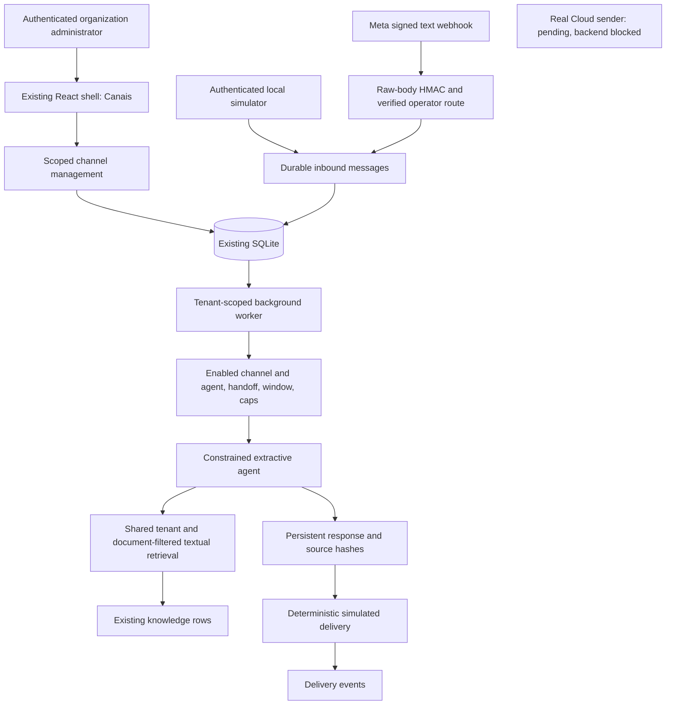

# Channel architecture and audit

Audit baseline: `origin/main` at `a9ec52c`, 2026-11-08. Initial working tree clean;
branch `feature/service-whatsapp`. AGENTS and delivery/product docs were reviewed.

## Existing core reused

| Concern | Actual repository implementation | Choice for this increment |
| --- | --- | --- |
| Identity | BCrypt/JWT, database-refreshed claims, active account/membership and organization validation on every request | Reuse for channel administration; add `channels.manage`, no external contact login |
| Organizations | `OrganizationScope`, EF query filters/write guards, Owner/Admin/Member/Viewer, workspace/invitation v7/v8 | Reuse; signed webhook registry and worker re-enter explicit validated scopes |
| Chat | User-owned `ChatSession`/`ChatMessage`, SSE, titles, usage | Preserve web chat; external contacts cannot own a user-authenticated session |
| Local knowledge | Bounded textual selection in `LocalChatContextService`, active tenant KB rows | Extract selection to shared `LocalKnowledgeRetriever`; both web chat and channels call it |
| Advanced RAG | Qdrant/ONNX embedding, relational payload revalidation, optional reranking in `KnowledgeBaseRagService` | Preserved; channel integration deliberately textual, no claim of semantic/ReRAG execution |
| Models | DeepSeek/OpenAI/Ollama adapters, router, provider settings and usage | Preserved; no external inference/cost in extractive simulator |
| Data | Tenant Trino profiles/group grants, closed read-only plans | No channel SQL/tools granted |
| Runtime | .NET8 gateway/OCR/ML, React18/TS/Vite/MUI, SQLite; Python scripts | One module in gateway, no new service/framework/storage engine |
| Delivery | Docker Compose, optional Trino/Qdrant/ONNX; migration checksums/backup | Add v9, exercise temporary upgrades and rollback; no live deployment or new ARM64 claim |

New external conversation tables are justified by the ownership boundary: an
external account/contact has no portal user ID, JWT or organization membership.
Mapping a phone number to a portal user or relaxing `IChatRepository` ownership
would allow disclosure of private web history. `IChannelConversationRepository`
therefore manages external history without touching existing conversations.

## Contracts and persistence

`IMessageChannelProvider`, `IInboundMessageHandler`, `IOutboundMessageSender`,
`IChannelConversationRepository` and `IChannelAgent` separate receipt, history,
agent generation and delivery. Only the simulator implements outbound delivery.
No unused generic agent/credential infrastructure is presented as implemented.

- `ChannelConnections`: organization, provider/account/phone IDs, display name,
  enabled state, opt-in automation, inline versioned agent assignment,
  authorized KB row IDs, retention/cap and concurrency version. Status is computed
  as simulated/disabled/receive-only-unverified, never fabricated health.
- `ChannelContacts`: identity scoped to connection, not globally to a phone number.
- `ChannelConversations`: connection/contact, last customer timestamp, handoff,
  last update and optimistic version. One current thread per contact/connection.
- `ChannelMessages`: durable inbox/outbox, external ID uniqueness per connection,
  direction, text/state, timestamps, retries and source IDs/content hashes.
- `MessageDeliveryEvents`: append-only local simulator events; schema reserves
  nullable provider pricing category/billable fields. Real status/pricing ingestion
  is pending, so no invented provider billing is recorded.

Composite relational keys bind tenant/connection/contact/conversation/message
references. EF tenant filters and write guards are additional checks. All public
management APIs require current database-backed permissions; creation also requires
KB view permission. A document whitelist is checked before saving and again by
active scoped retrieval, so deactivated/foreign documents cannot become evidence.

There is no separate `AgentAssignments` table: the single supported constrained
agent and authorized document set are part of each connection's versioned record.
General agent definitions, instruction editors and assignment history need their
own reviewed increment. External history does not automatically feed the model.

## Processing and failure boundaries

Webhook HMAC covers raw bytes and uses fixed-time comparison. Routing requires
both WABA and destination phone IDs, the database binding and an independent
operator-owned organization map. An arbitrary signed payload/tenant header cannot
rebind another organization's number. Unknown/unsupported events are acknowledged
without creating customer messages. Echo/history/media/status payloads cannot
trigger replies in this MVP. Invalid authentication is denied before database work.

Inbox insertion commits before acknowledgement. Unique IDs and serialized SQLite
transactions deduplicate simultaneous/replayed input. The worker discovers active
organization IDs only, then creates a fresh scope for content. It processes up to
20 inbound/outbound rows per iteration and never calls a remote sender. Response
creation and deterministic simulated delivery events commit atomically. A restart
retries persisted queued work without generating duplicate responses.

Do not put real network sends inside this transaction: remote acceptance and local
commit cannot be atomic. The next Cloud increment needs send leases, retryable vs
permanent/ambiguous failure states, recipient/body binding, provider-message ID
reconciliation, rate/Retry-After handling and status deduplication. Timeout must
never lead to blind resend. Backend blocks Cloud automation meanwhile.

Retrieved text is evidence only. The constrained agent has no SQL, network tools,
model credentials or policy-changing interpreter. No outside contact can expand
document grants through a prompt. Response references include document ID/title,
creation timestamp and content hash; no fabricated token count or cost is stored.

## Migration and recovery

`009_Channels.sql` adds five tables/indexes only. Old migration checksums remain
unchanged. Existing SQLite receives a consistent pre-v9 backup, schema/ledger
validation and transactional DDL. Fresh installations use matching EF mappings.
Tests cover v8 preservation, repeat startup, backup restoration/re-upgrade and
late-index-collision rollback. Historical fixtures explicitly exclude newer tables.

Operational rollback: stop the gateway; restore the complete protected pre-upgrade
backup at a new path; use the previous binary and verify integrity. Reconcile
post-upgrade writes first. No destructive live-table down migration is supplied.
No migration/reset was executed against the user's running database.
