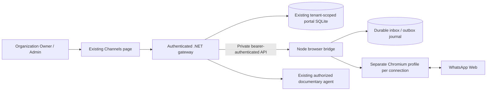

# Server-side WhatsApp Web bridge

This experimental channel runs Chromium on the portal host. It does not require
the Meta Cloud API setup. One organization can create multiple connections; each
has a separate Chromium profile, lifecycle and message history. The previous Cloud
receive-only adapter remains available but is no longer the default setup guide.

## Components and trust boundaries



The gateway derives organization identity from validated membership, resolves the
connection within its query filter, and then addresses the bridge by organization
and connection UUID. Clients cannot select a bridge URL or submit an organization
to claim another session. The bridge is internal only, has no published port, and
requires a randomly generated installation secret. QR/status responses are
`no-store`. QR images, tokens and message bodies are not logged. A server registry
prevents the same account being bound to multiple connections, including other
organizations. Logout releases that binding.

The bridge uses `whatsapp-web.js` with `LocalAuth`. Its browser operations are
isolated from the .NET process. Profiles and journal survive a bridge restart;
only sessions explicitly started by an administrator resume automatically.
Stopping a session preserves its profile. Logout attempts remote unlink when the
client is available, removes the local profile, and requires new pairing. If the
browser was offline, also remove the device in the phone's linked-device screen
to ensure remote revocation.

Browser profiles contain account-access material. Keep their Docker volume and
backups private; use encrypted host storage for deployment. This local Compose
profile runs Chromium as a non-root user with dropped container capabilities,
but uses `--no-sandbox` for Docker compatibility. Shared-container profiles are
application isolation, not an OS security boundary between untrusted browser
processes. Per-session/container hardening is required before offering this as a
public multi-customer production service.

## Available behavior

- Register multiple browser connections without manually entering provider IDs.
- Pair by private QR, inspect state, pause, reconnect, and forget a session.
- States: disconnected, starting, awaiting QR, authenticating, connected,
  reconnecting, pairing expired, account already bound.
- QR TTL is 60 seconds; expired unattended codes stop the session. Provider QR
  rotation can replace a code before it expires. Reconnection uses bounded
  exponential backoff from 5 to 300 seconds. Authentication expiry requires the
  administrator to pair again. A periodic heartbeat detects lost browser sessions.
- Receive individual text messages only. Echoes, groups, media and blank/oversized
  messages are ignored. No historical conversation import.
- Durable inbox is acknowledged only after portal persistence (or rejection of
  an invalid/expired item). Both sides deduplicate provider message IDs.
- Automatic replies start off. The existing agent retrieves only explicitly
  authorized documents; it is extractive, not an external LLM agent.
- Enable human handoff to send a manual reply in the existing conversation page.
- Monthly per-connection and per-organization response caps, retention and the
  conservative 24-hour response window also apply to browser channels. This is
  portal policy, not a claim that the browser adapter enforces Cloud API billing.
- Disable a channel or organization to stop its browser. Account revocation is
  a separate logout action. Re-enabling a paused channel requires reconnecting.

## Delivery correctness

Portal output is committed before a browser operation. A stable message UUID is
also the idempotency key in the bridge journal. The bridge records `sending`
before invoking WhatsApp, and stores the provider message ID on acceptance.
Acknowledgment events update sent/delivered/read states. A send exception, timeout
or bridge crash during sending becomes **unknown**, without automatic resend.
This avoids blindly replaying a potentially accepted message; it does not promise
exactly-once delivery through an unofficial remote system. Unknown outcomes need
human inspection. A server-accepted message is not represented as delivered.

The portal remains a single-node SQLite worker. Do not scale gateway/bridge
replicas against the same profiles. Bridge inbox content is removed after portal
acknowledgment; minimal deduplication IDs remain. Pending unacknowledged content
and profile erasure require operator lifecycle management and private backups.

## Local operation

Preserve `.env`, the current Compose overrides and all existing volumes. Generate
a random secret of at least 32 characters into a private env file outside Git:

```text
WHATSAPP_BRIDGE_SECRET=<random-private-value>
```

The local installation uses `C:\oci\ia-portal\whatsapp-browser-local.env`.
Never print `docker compose config` with secrets; use `config --quiet`.

```powershell
docker compose --env-file .env --env-file C:\oci\ia-portal\whatsapp-browser-local.env -f docker-compose.yml -f docker-compose.atlas.yml -f docker-compose.whatsapp-browser.yml config --quiet
docker compose --env-file .env --env-file C:\oci\ia-portal\whatsapp-browser-local.env -f docker-compose.yml -f docker-compose.atlas.yml -f docker-compose.whatsapp-browser.yml build whatsapp-bridge ai-gateway portal-front
docker compose --env-file .env --env-file C:\oci\ia-portal\whatsapp-browser-local.env -f docker-compose.yml -f docker-compose.atlas.yml -f docker-compose.whatsapp-browser.yml up -d --no-deps whatsapp-bridge ai-gateway portal-front
```

Open `http://127.0.0.1:9080/channels`, select the active organization, choose
**WhatsApp Web · navegador no servidor**, name the connection and select documents
the agent may disclose externally. Create it, select it, and click
**Conectar / reconectar**. On the consenting account's phone, use linked devices
to scan the QR. Do not share screenshots containing the code.

No portal migration is needed: the existing provider discriminator and channel
entities are reused. The bridge creates only its own journal in a new private
`whatsapp_sessions` volume. Never delete the portal volume to install this module.

## Validation and measurement

```powershell
npm ci --prefix whatsapp-bridge --ignore-scripts
npm test --prefix whatsapp-bridge
npm audit --prefix whatsapp-bridge
dotnet run --project tests/Channels
python scripts/smoke_channels.py
npm run typecheck --prefix front
python scripts/measure_browser_bridge.py --samples 3 --interval 10
```

The HTTP smoke uses real portal authentication/SQLite/worker with a synthetic
bridge, never a real account. It exercises private routing, durable manual output,
handoff, repeated request IDs and foreign-tenant/Member denial. Bridge unit tests
exercise lifecycle, expiry, account ownership, ambiguous delivery and restart.
Browser fixture tests cover controls and existing themes/responsive behavior.
The explicit live test `tests/ui/browser-channels-live.cjs` creates/reuses a local
test channel and starts an unpaired Chromium session; it neither captures QR
images nor sends messages. A successful QR test is not end-to-end messaging.

Dependencies are locked. Puppeteer is overridden to a patched version and tested
against the wrapper; repeat QR/session validation when updating either dependency.
Chromium comes from Debian packages, not an uploaded/downloaded archive API.
ARM64 and unattended long-running paired sessions need separate validation.
Resource CSV samples describe the current local workload, not a 100-client capacity
guarantee. Host RAM and Docker's memory budget are separate constraints.

Primary integration references:
[client lifecycle and events](https://docs.wwebjs.dev/Client.html),
[LocalAuth](https://docs.wwebjs.dev/LocalAuth.html),
[project source](https://github.com/wwebjs/whatsapp-web.js).
This connector depends on WhatsApp Web compatibility and can require updates;
no official Meta support or production availability guarantee is implied.
