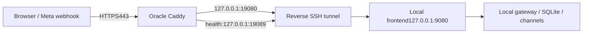

# Oracle HTTPS edge to the local Windows portal

The public domain stays pointed at the existing Oracle Micro IPv4. Its Caddy
keeps TLS termination and certificate renewal. A workstation-initiated SSH reverse
tunnel forwards all frontend/API requests to the existing local stack. No modem
login, inbound workstation ports, DNS change or new cloud resource is needed.



Only remote loopback listeners19080/19089 are allowed. Neither is opened in OCI or
host firewall. SSH strict known-host verification, batch authentication,
ExitOnForwardFailure and keepalive are mandatory. The existing private key stays
on Windows and is never uploaded. The remote SSH service must allow forwarding;
`GatewayPorts` must not force public binding. Activation checks the actual socket
bindings before changing the HTTPS edge.

## Start the runner locally

Keep the hostname's A record at the Oracle public IPv4 and do not add a local AAAA
for this topology. Ensure local Docker frontend9080/gateway9089 are running.

```powershell
# Default: inspect safe arguments, without opening a connection.
powershell -NoProfile -ExecutionPolicy Bypass -File infra/local/reverse-tunnel.ps1 -RemoteHost YOUR_VM_IP -KeyPath C:\oci\YOUR_PRIVATE_KEY
# Foreground runner; Ctrl+C stops its SSH child.
powershell -NoProfile -ExecutionPolicy Bypass -File infra/local/reverse-tunnel.ps1 -RemoteHost YOUR_VM_IP -KeyPath C:\oci\YOUR_PRIVATE_KEY -Run
```

For unattended interactive operation, launch the same runner with PowerShell
`Start-Process -WindowStyle Hidden`; do not store passwords or key contents in
arguments. One per-user mutex prevents duplicate runners. The private state path
is `%LOCALAPPDATA%\IA-Portal\reverse-tunnel`, with process identity, current SSH
child, error file and bounded-information operation messages. Connection attempts
retry every15 seconds; keepalive detects broken connections. While the local
gateway is unavailable the runner waits instead of reporting successful forwarding.
SSH process existence alone does not prove tunnel health: check both forwarded
HTTP endpoints from the VM. No scheduled task is installed; restart the runner
after workstation reboot/logon. The workstation must remain powered on and awake.

```powershell
powershell -NoProfile -ExecutionPolicy Bypass -File infra/local/stop-reverse-tunnel.ps1
```

The stop helper verifies executable/start-time and runner script identity before
stopping recorded processes, including a recorded orphan child. It does not stop
other SSH sessions or the independent Always Free provisioning runner.

## Activate the edge after SSH recovery

Copy `Caddyfile.local-tunnel` and `activate-local-edge.sh` to the VM via SCP, without
private keys or env files, then run the helper as the existing deployment user:

```bash
bash activate-local-edge.sh YOUR_HOSTNAME "$HOME/Caddyfile.local-tunnel"
```

The helper targets only the existing `/run/ia-portal-docker.sock` deployment. It
checks remote binds, actual forwarded frontend/readiness, validates Caddy, stops
and preserves the original web container under a timestamped name, and starts a
replacement using the same image/certificate volumes with the new read-only
Caddyfile. Failed launch or local HTTPS validation restores the old web container.
Successful activation records the backup container name under
`/opt/ia-portal/edge/previous-web-container`. No cloud database is erased/copied.

Verify externally that HTML/assets match the workstation, normal TLS succeeds,
API authorization remains required and an authenticated request uses the expected
local organizations/history. Existing browser JWTs from the old cloud instance
may require logging in again because the local installation uses its own key and
users. Stop the old cloud API only after this verification to release memory;
preserve its container and data for deliberate rollback.

There is intentionally no automatic fallback to the old cloud database on tunnel
failure. A failed tunnel returns unavailable rather than silently mixing two
installations. Full rollback uses the recorded old web container: stop/remove only
the replacement `ia-portal-web`, rename the recorded backup back to `ia-portal-web`,
start it and ensure the preserved `ia-portal-api` is running. Verify the exact
container labels/names before any remove operation.

## WhatsApp and logs

The callback remains `https://YOUR_HOSTNAME/api/webhooks/whatsapp` and now reaches
the local gateway. Operator-verified organization binding, fresh App Secret and
verify token remain necessary. Cloud sending is still a separate unimplemented
feature; a tunnel alone does not subscribe the Meta app or send messages.

The new edge filters request URI/headers out of runtime error logs. Local Nginx
disables access/error URI logging specifically for the webhook, including its
optional trailing slash. Gateway default logging is Error. Never enable verbose
request logging containing verification query tokens, payloads or auth headers.

## Validation and status2026-11-09

- PowerShell dry-run/tests: loopback forwards, strict host verification, keepalive,
  shell-like host rejection and unrelated-process stop denial passed.
- Actual runner launched hidden locally; duplicate runner attempt exited without
  opening another SSH process. No key contents were read out or transferred.
- Caddy native validation and Bash syntax passed. Isolated container tests passed
  non-loopback/unreachable tunnel denial, launch/HTTPS failure rollback and
  successful/idempotent edge activation. These are synthetic remote-operation tests.
- At preparation time OCI reported the existing Micro RUNNING, but SSH banner and
  HTTPS requests timed out repeatedly. The runner retries; no actual connected
  tunnel or remote edge switch is claimed. A soft VM restart was requested from
  the owner and is pending. No reboot or remote configuration change was made.

The active service remains unverified until VM recovery and real external checks.
Do not treat a successful mock activation or a running retry process as deployment.

Subsequently the owner authorized a soft VM reboot. One OCI SOFTRESET was submitted
and the instance entered STOPPING. No second/reset/force action was requested.
`complete-local-tunnel.py` is the optional bounded completion worker: it never
reboots, waits for SSH and both forwards, uploads only the two public proxy files,
invokes activation, verifies normal public TLS and exact local frontend HTML,
uses a local JWT to compare authorized organizations through the public endpoint,
checks anonymous401, and only then stops the old cloud API. No messages or LLM
calls are generated. Credentials are read from a private local file, never arguments
containing secret values. A lock prevents duplicate workers. Safe phase/status is
written to `activation-status.json`; default waiting window is30minutes.
