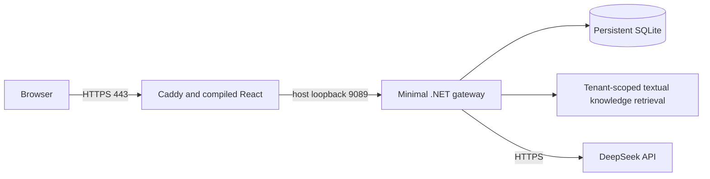

# Minimal OCI Micro deployment

**2026-11-09 follow-up:** the full-stack attempt and repair of a448MiB kernel crash
reservation are recorded in [FULL_CAPACITY_TRIAL.md](FULL_CAPACITY_TRIAL.md).
The complete RAG/Trino stack did not fit; the minimal deployment was preserved.

Deployment validated on **2026-11-08 (America/Sao_Paulo)**, after the owner explicitly
authorized the minimal deployment, use of the existing DeepSeek credential and
the domain `santaluz.ddns.net`. Earlier no-deploy instructions applied to previous
tasks; this deployment is the subsequent explicitly requested step.

Live URL: **https://santaluz.ddns.net**. This is a small demonstration installation,
not a capacity/SLA claim for a managed SaaS.

## Actual topology



- Existing `VM.Standard.E2.1.Micro`, Oracle Linux9.8, x86_64, 945MiB usable RAM,
  944MiB swap. No new VM, volume, paid resource or shape change was made.
- Two prebuilt linux/amd64 images, built on the Windows workstation's Docker
  Desktop. No SDK, Node build, OCR, ML, Qdrant, Trino, ONNX model or Ollama service
  runs on the VM. The compiled gateway still contains its existing optional
  libraries; vector models are not loaded in the minimal path.
- Caddy2.11.9 serves the existing React bundle and terminates HTTPS. Its certificate
  was actually issued and verified by the public client; HTTP redirects to HTTPS.
  Certificate/account storage is persisted privately under `/opt/ia-portal`.
- Dedicated official static Docker29.9.3 runtime, systemd-enabled as
  `ia-portal-docker.service`, private root socket `/run/ia-portal-docker.sock`.
  No Docker TCP API. Host networking avoids bridge/NAT modifications; API binds
  **127.0.0.1:9089** and only Caddy listens publicly on80/443. Caddy admin API is off.
- OCI security list and host firewalld allow80/443. SSH22 remains open to IPv4
  addresses at the owner's explicit request for CGNAT. No internal API/data port
  was opened. Existing ICMP/egress rules were preserved.

The original full Compose stack and running local installation were preserved.
This cloud deployment has a **new independent database**, not a copy of local
users/documents/history. Only generic technical-support template documents and a
clearly synthetic validation document were imported.

## Resource and feature policy

| Component | Policy |
| --- | --- |
| API | 384MiB container limit, 640MiB combined memory/swap, workstation build, non-root app user, read-only root filesystem and bounded tmpfs |
| GC | Workstation GC, 160MiB managed heap limit; native/runtime allocations are additional |
| Frontend/HTTPS | 96MiB memory, 128MiB combined memory/swap, Go heap target64MiB |
| Requests | 10 login attempts/minute/client IP, 128 other requests/minute/client IP; two chat generations globally, no queue |
| Proxy | Only loopback forwarded headers trusted by the API; Caddy request bodies capped at1MiB |
| Logs | Per-container rotation at5MiB, two files; no secret/body logging added |
| Heavy capabilities | `Hosting__Minimal=true`, `Chat__UseAdvancedRag=false`; OCR, SQL/data connectors and vector reindex return503 after normal authorization; source list is honestly empty |
| UI | Compile-time minimal flag hides attachments and connector navigation; backend gates remain authoritative |

The default full deployment remains unchanged when `Hosting:Minimal` is off.
No persistence migration was added by this increment. Existing checksummed
migrations001–009 ran automatically on the new VM database. Data is under
`/opt/ia-portal/data`, owned by the container app UID1654. Existing database upgrades
retain the established pre-upgrade backup behavior.

## Validation and observations

| Check | Result |
| --- | --- |
| Gateway image/.NET build, frontend image/typecheck/build | PASS; existing compiler and frontend bundle-size warnings remain |
| `dotnet run --project tests/MinimalHosting` | PASS: resource gates, empty sources, standard mode preserved, two-chat cap and release after exceptions |
| `dotnet run --project tests/BusinessChat --no-restore` | PASS |
| `python scripts/smoke_organizations.py` | PASS: real temporary API/SQLite/JWT organization/invitation/ownership regression |
| `python scripts/smoke_local.py --atlas` | PASS: baseline chat, providers, usage, history/restart and connectors with local doubles |
| Actual isolated local minimal containers | PASS: non-root SQLite startup, login, KB, feature gates and actual429 login throttling |
| Public HTTPS/health/readiness/login/KB/template | PASS, normal TLS verification, no certificate bypass |
| Public read smoke | 24 authenticated KB reads, concurrency3, zero failures; observed median0.094s/max0.193s on the later run; not a production load test |
| Real DeepSeek | PASS: one synthetic document question plus automatic title, grounded code in the persisted assistant answer; provider usage appears in the portal |
| Idempotent SSE replay | PASS: same session/request returns the saved answer without another model call |
| Controlled API container restart | PASS: account, KB and grounded answer persisted; no user/database reset |
| Real Chrome HTTPS browser | PASS: login and chat, minimal controls, dark/light screenshots; no model call from browser test |
| Eight runtime samples | API177.9–193.0MiB, Caddy34.29–71.19MiB, host available369–404MiB; OOM=false and zero automatic restarts throughout |
| Later post-restart snapshot | Host available424MiB, swap159MiB used, root filesystem23GiB available |
| Final service snapshot | Web up10minutes, API up5minutes after the planned restart; API106MiB, Caddy36.17MiB, public readiness200 |

The initial VM preparation exposed a real limit: DNF metadata processing consumed
about585MiB in one process and SSH stopped responding while package preparation
was running. A controlled OCI soft restart restored access. Podman installation
did not complete. We switched to official static Docker binaries downloaded on
the workstation, without rerunning the large package metadata workload. Do not
run unattended DNF updates or builds alongside the application on this machine.

During validation, the first SSE assertion incorrectly searched for a complete
code across raw token chunks. The actual response had completed and persisted
correctly. The checker now verifies SSE events and the assembled saved answer;
the same turn was replayed without additional inference. Initial local proxy/
startup/configuration issues were fixed before public acceptance.

Sampling covered roughly two minutes plus API/browser/restart checks, not hours
or days. Full host reboot after installation, sustained multi-user traffic,
disaster recovery, API abuse across many IPs and long-term memory growth remain
unverified. The systemd runtime is enabled for boot; only API restart was tested.

## Private access and configuration

Initial login is recorded only in the protected workstation file:

`C:\oci\ia-portal\admin-access.txt`

The private `runtime.env` is beside it and on the server at
`/opt/ia-portal/runtime.env` (mode600). It contains a new JWT secret, independent
initial admin password and the **explicitly approved** DeepSeek key. No `.env` was
modified, no API key was put in SQLite/frontend/Git/logs, and no private SSH key
was uploaded. Rotate the initial admin password in the portal after signing in.
Keep the configuration/backups private; Docker root-level inspection can read
container environment. An environment-backed key is not a tenant secret vault.

The DeepSeek provider is external and may charge. No rate/free allowance is
assumed. OpenAI/Ollama are disabled. Do not run `--live-llm` merely to check health;
normal readiness probes do not call a provider.

## Reproduce a deployment

Use a **new immutable image tag** for each subsequent release. The initial tag
used here was `micro-20261108`; final image IDs:

- Gateway: `sha256:e0c452d6e733067d62bcac91d95b4514fc41a0a40a5c05a9fdbc84f7e00da0da`
- Frontend: `sha256:350ec90cb2d5d98bec3fa8ababbd656dc90ba83a6373d060c7b825e02c5f5cd4`

Workstation build commands, with no credentials in build arguments:

```powershell
docker build --platform linux/amd64 -f infra/oracle/Dockerfile.gateway-minimal -t ia-portal/gateway:micro-20261108 ai-gateway
docker build --platform linux/amd64 --build-arg VITE_MINIMAL_HOSTING=true -t ia-portal/frontend:micro-20261108 front
docker build --platform linux/amd64 -f infra/oracle/Dockerfile.frontend-minimal -t ia-portal/frontend-tls:micro-20261108 .
```

The frontend TLS build accepts `FRONTEND_ASSETS_IMAGE` to select the corresponding
prebuilt frontend tag. Its dedicated ignore file admits only Caddy configuration
from the root build context. Export images with `docker save`, compress locally,
then transfer by SCP; never publish an archive containing private configuration.

For a **new** VM, the operator supplies an official static runtime archive from
[Docker's HTTPS distribution](https://download.docker.com/linux/static/stable/x86_64/),
transfers the reviewed `install-static-runtime.sh`, and runs it with the archive
path. It refuses to replace an existing Docker installation. After loading images
and privately placing `runtime.env`, first startup is:

```bash
PORTAL_SITE=your-verified-domain.example bash /opt/ia-portal/start-minimal.sh
```

This assumes the operator has already validated DNS, allowed80/443 and reviewed
the machine. The script refuses existing app containers rather than deleting
them. It does not create cloud resources or alter firewall/DNS. The Caddy process
requests/renews public certificates automatically; preserve its data directory.
See [Caddy HTTPS requirements](https://caddyserver.com/docs/automatic-https).

For isolated **local** validation, `compose.minimal.yml` is standalone: do not
combine it with the regular/Atlas Compose files. Set `GATEWAY_IMAGE`,
`FRONTEND_IMAGE`, `RUNTIME_ENV_FILE` to an external private path and `PORTAL_PORT`
to a free loopback port, then use a separate Compose project name. The deployed
VM uses the documented dedicated Docker service/host networking, not Compose.

## Monitoring, backups and updates

```bash
sudo systemctl status ia-portal-docker.service
sudo docker --host unix:///run/ia-portal-docker.sock ps
sudo docker --host unix:///run/ia-portal-docker.sock stats --no-stream
bash /opt/ia-portal/measure-minimal.sh 8
curl -fsS https://santaluz.ddns.net/health/ready
```

From the workstation, with explicit private configuration:

```powershell
python scripts/smoke_minimal.py --url https://santaluz.ddns.net --credentials-file C:\oci\ia-portal\runtime.env
# Only when explicitly intended: append --live-llm (may consume balance).
```

Before future updates, create and verify a consistent SQLite backup with Python's
SQLite backup API (not a blind copy while WAL is active), protect runtime.env and
Caddy storage separately, record the current image IDs, then stop/recreate only
the two named application containers with the same persistent paths. Never remove
`/opt/ia-portal/data` or Caddy data to upgrade. Do not rerun the first-install script
to replace an existing runtime. Static binaries require explicit maintenance;
there is no automatic package update mechanism for them.

If memory pressure recurs, stop the application containers through the dedicated
Docker socket, keep their files, inspect kernel/runtime OOM events and recover
through SSH/OCI console. Do not blindly increase swap/caps or restart all services.
Do not add Trino, local inference or OCR based on this small read smoke.

Next operational work: regular off-VM backup/restore verification, longer sampling,
reviewed update/rollback tooling and ongoing patch/privacy/audit policy. Before
adding heavy features or more users, measure the actual workload or obtain the
larger approved Always Free capacity; this delivery does not certify production
readiness or guarantee OCI/provider cost zero.
